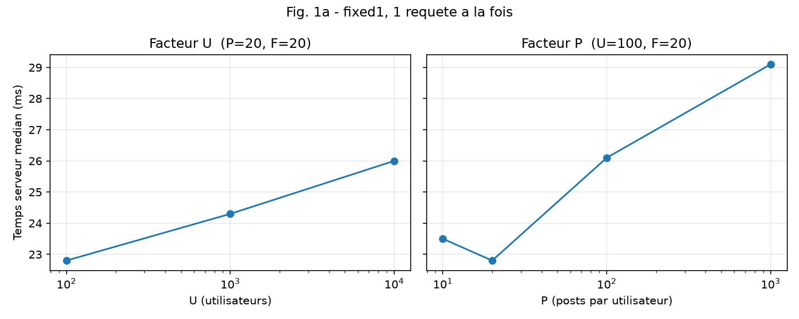
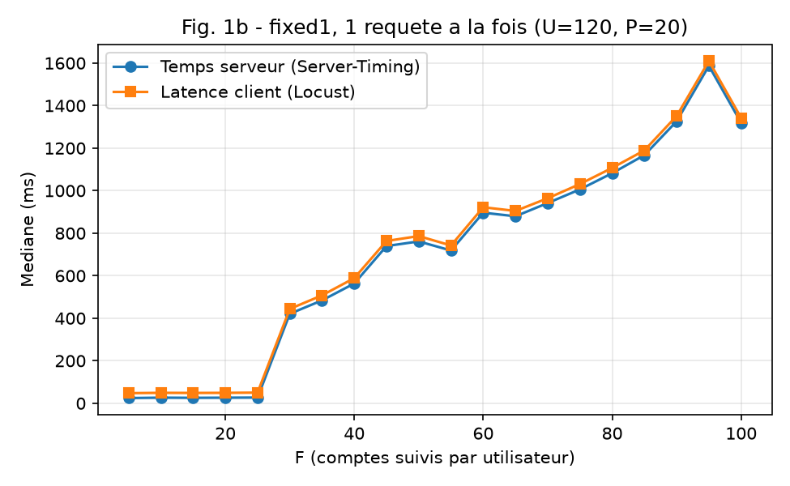
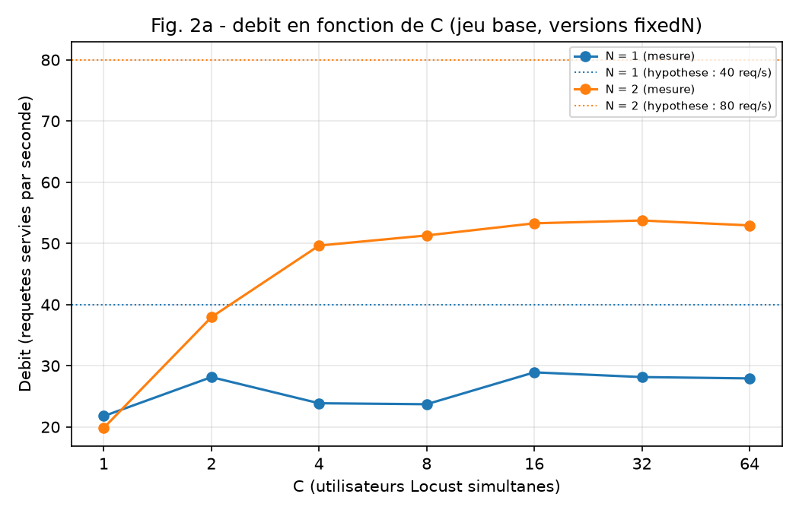
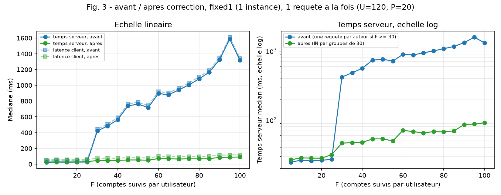

# Projet Données Massives et Cloud : TinyInsta passe-t-elle à l'échelle ?

**Benchmark, édition 2026. Rendu individuel. Yasmine Bour.**

- Application déployée (version par défaut) : https://tinyinsta-510215.oa.r.appspot.com
- Dépôt : https://github.com/YasmineBour/Projet_tinyInsta_2026

**Réponse en une phrase.** TinyInsta passe à l'échelle sur le nombre d'utilisateurs (U), sur le nombre de posts par utilisateur (P) et sur le nombre d'instances (N). Elle ne passe pas à l'échelle sur le nombre de comptes suivis (F), même après ma correction, qui réduit pourtant beaucoup le temps de réponse (voir la conclusion).

**Sommaire.** 1. Montage, 2. Résultats des parties 1 à 3, 3. Tableau des verdicts (et conclusion), 4. Validité, 5. Coût de la campagne, puis l'organisation du dépôt.

---

## 1. Montage

**Projet et région.** Projet GCP `tinyinsta-510215`. L'application tourne sur App Engine en région `europe-west6` (Zurich). Les données sont dans Cloud Datastore (Firestore en mode Datastore).

**D'où tourne le client.** Locust 2.47.0 (Python 3.12) est lancé depuis Cloud Shell. La machine Cloud Shell est en zone `europe-west1-b` (Belgique), lue avec le serveur de métadonnées de Google. Le client et l'application ne sont donc pas dans la même région.

**Versions de l'application.**

| Version | Instances | Classe | Utilisée pour | Date (heures en UTC) |
|---|---|---|---|---|
| `20260930t152203` (version par défaut) | autoscaling, au plus 10 | F1 | URL rendue, doit rester fonctionnelle. Elle contient l'ancien code. | déployée le 30/09/2026 |
| `fixed1` | 1 fixe | B1 | Partie 1 (26 runs) | 30/10/2026, de 19h06 à 19h33 environ |
| `fixed1b` | 1 fixe | B1 | Partie 2, N = 1 | 09/11/2026, de 10h15 à 10h37 (deux sessions) |
| `fixed2` | 2 fixes | B1 | Partie 2, N = 2 | 09/11/2026, de 10h56 à 11h03 |
| `fixed4` | 4 fixes | B1 | Partie 2, N = 4 | 09/11/2026, de 11h11 à 11h19 environ |
| `fixchunk` | 1 fixe | B1 | Partie 3 (version corrigée, déployée avec `--no-promote`) | 19/11/2026, de 10h19 à 10h40 |

Les versions `fixedN` et `fixchunk` utilisent la classe B1, imposée par le script `deploy_fixed.sh`, alors que la version par défaut utilise F1. Le fichier `main.py` du dépôt contient la correction de la partie 3, mais la version par défaut déployée contient toujours l'ancien code, car `fixchunk` n'a pas été promue. Chaque version `fixedN` et `fixchunk` a été arrêtée après ses mesures.

**Jeux de données.** 26 jeux, environ 400 000 entités, générés un par un avec `bench/seed_exact.py` : `base`, `u100`, `u10000`, `p10`, `p100`, `p1000` et `f05` à `f100`. <!-- À compléter : dates de génération -->

**Deux incidents.**
- La version `fixed1` est restée bloquée par une opération App Engine en attente (déploiement par-dessus une version arrêtée). J'ai donc utilisé `fixed1b` pour N = 1 en partie 2, avec exactement la même configuration.
- Ma première campagne de la partie 3 a donné des runs vides à cause d'une erreur dans mon script (une commande de délai maximal empêchait Locust de démarrer). J'ai corrigé le script et refait toute la campagne.

---

## 2. Résultats des parties 1 à 3

### 2.1 Partie 1 : coût d'une requête

**Question :** de quoi dépend le temps de traitement d'une timeline ?

#### Hypothèse

En lisant `get_timeline` dans `main.py`, je remarque que la fonction contient deux blocs `try`, donc deux méthodes pour construire la timeline.

**Méthode 1 : requête groupée.** Elle utilise une requête (de type SQL, ici une requête Datastore) qui sélectionne les posts dont l'auteur appartient à la liste de followees récupérée. Comme on sélectionne tous les posts de ces auteurs, plus P est grand, plus la requête va mettre du temps.

**Méthode 2 : boucle.** Elle parcourt chaque auteur de la liste `follows` pour récupérer les posts de chacun. Donc, si la liste est grande, le temps de réponse l'est aussi.

**Prédiction :** si P et F augmentent, le temps de réponse du serveur augmente. En revanche, U ne semble pas influer sur la fonction, car c'est un utilisateur qui est passé en paramètre.

| Facteur | Évolution attendue du temps serveur | Mécanisme (`get_timeline`) |
|---|---|---|
| U (utilisateurs) | Pas d'effet | L'utilisateur est passé en paramètre : la fonction ne travaille que sur sa liste de followees et sur leurs posts. |
| P (posts par utilisateur) | Augmente | La requête sélectionne les posts des auteurs de la liste : plus ils en ont, plus elle est longue. |
| F (followees) | Augmente | Plus la liste `follows` est grande, plus la requête est lourde (méthode 1) et plus il y a d'itérations dans la boucle (méthode 2). |

#### Protocole

**Montage.** Version `fixed1` (exactement 1 instance, sans autoscaling), une requête à la fois (Locust `-u 1 -r 1`). Projet GCP `tinyinsta-510215`, région App Engine `europe-west6`. Client de charge : Locust 2.47.0, lancé depuis Cloud Shell. Mesures réalisées le 30/10/2026.

**Jeux de données.** Chaque jeu est généré avec `bench/seed_exact.py` (exactement P posts et F followees par utilisateur). Un seul facteur varie à la fois, les autres restent à leur valeur de référence.

| Facteur étudié | Jeux utilisés | U | P | F |
|---|---|---|---|---|
| U | `u100`, `base`, `u10000` | 100 / 1 000 / 10 000 | 20 | 20 |
| P | `p10`, `u100`, `p100`, `p1000` | 100 | 10 / 20 / 100 / 1 000 | 20 |
| F | `f05`, `f10`, ..., `f100` (20 jeux) | 120 | 20 | 5 / 10 / ... / 100 |

Le point P = 20 de la courbe de P est mesuré sur `u100` (U = 100, P = 20, F = 20), qui est le seul jeu à 100 utilisateurs et 20 posts.

**Déroulement.**
- 26 runs, un par jeu, de 60 secondes chacun. Chaque run produit un journal brut `raw/<jeu>.csv` (une ligne par requête : latence client, temps serveur, code HTTP, instance).
- Avant la campagne, un échauffement de 20 secondes sur `base` (non conservé) évite que le démarrage à froid de l'instance fausse le premier run.
- Les runs sont lancés dans un **ordre mélangé** (tirage avec graine fixe, enregistré dans `raw/order.txt`), pour que l'ordre n'avantage ni ne pénalise un facteur plus qu'un autre.
- Avant chaque run, le script vérifie que la timeline d'un utilisateur du jeu renvoie bien 20 posts.
- Chaque jeu n'est mesuré qu'une seule fois.

**Traitement.**
- Les 5 premières secondes de chaque run sont écartées. Le journal brut les conserve.
- Seules les réponses HTTP 200 sont gardées pour les médianes.
- Pour chaque run, on calcule la médiane du temps serveur (`SERVER_MS`, en-tête `Server-Timing`, durée de `get_timeline`) et la médiane de la latence client (`LATENCY_MS`, mesurée par Locust).
- Le nombre d'instances qui ont réellement répondu est compté à partir de la colonne `INSTANCE` (en-tête `X-Instance`) : il vaut 1 pour les 26 runs. Les 26 runs n'ont renvoyé que des codes 200.

**Reproductibilité.** `scripts/campagne_p1.sh` lance les mesures. `python3 scripts/analyse_p1.py` lit `raw/` et régénère tous les CSV et PNG de `figures/` ainsi que le résumé `figures/resume_p1.csv`.

**Utilisateur interrogé.** D'après `bench/locustfile.py`, chaque utilisateur Locust interroge un utilisateur TinyInsta qui lui est propre, pris dans l'ordre (`<jeu>_u00000`, puis `_u00001`, etc.). Avec `-u 1`, chaque run mesure donc toujours le même utilisateur, `<jeu>_u00000`. Voir la section 4 (question 5).

#### Figures

**Fig. 1a** : temps serveur médian (ms) en fonction de U (à gauche, avec P = 20 et F = 20) et de P (à droite, avec U = 100 et F = 20), abscisses en échelle logarithmique. `fixed1`, une requête à la fois. Valeurs tracées : `figures/fig1a.csv`.

**Fig. 1b** : temps serveur médian et latence client médiane (ms) en fonction de F, pour 20 valeurs de F (U = 120, P = 20). `fixed1`, une requête à la fois. Valeurs tracées : `figures/fig1b.csv`.

Le résumé de tous les runs (nombre de requêtes, instances distinctes, codes HTTP, médianes) est dans `figures/resume_p1.csv`.

#### Interprétation et réponses aux questions

Dans `get_timeline`, il y a deux façons de récupérer les posts. J'appelle la première la **méthode IN** : une seule requête qui demande les posts de tous les auteurs d'un coup. J'appelle la deuxième la **méthode boucle** : une requête par auteur, l'une après l'autre. Le code contient aussi une version GQL, mais elle ne s'exécute jamais chez moi, car `client.gql` n'existe pas dans la bibliothèque installée.

Le code essaie d'abord la méthode IN. Si Datastore refuse, l'erreur est attrapée par le `except` et le code passe à la méthode boucle, sans afficher aucun message.

J'ai fait un test directement sur Datastore avec des `IN` de plus en plus grands. Avec 30 valeurs, ça marche. Avec 31 valeurs, Datastore répond « IN supports up to 30 values ». Une timeline demande les posts de F comptes suivis plus ceux de l'utilisateur, donc F + 1 auteurs. Jusqu'à F = 29, c'est la méthode IN qui répond. À partir de F = 30, c'est la méthode boucle.

##### Question 1 : mes hypothèses sont-elles confirmées ? Sinon, qu'avais-je manqué ?

**U : confirmé.** Je pensais que U n'avait pas d'effet, car l'utilisateur est donné en paramètre. Les mesures donnent 22,8 ms pour U = 100 et 26,0 ms pour U = 10 000. Le temps serveur ne monte que de 3 ms alors qu'il y a 100 fois plus d'utilisateurs.

**P : plutôt réfuté.** Je pensais que le temps augmentait avec P, car la requête parcourt tous les posts avant d'en renvoyer 20. Les mesures donnent 23,5 ms pour P = 10 et 29,1 ms pour P = 1 000. Le temps augmente d'environ 6 ms alors que P est multiplié par 100. Si la requête lisait tous les posts, le temps serait bien plus grand. Je n'avais pas vu le `limit=20` : la requête s'arrête dès qu'elle a 20 posts. Une explication probable est que l'index `(author, created desc)` donne déjà les posts triés par date, donc Datastore lit directement les plus récents. Je ne l'ai pas mesuré, donc je dis « probablement ».

**F : le sens est confirmé, mais pas la forme.** Je pensais que le temps augmentait avec F à cause de la boucle. C'est vrai, mais seulement à partir de F = 30. Jusqu'à F = 25, le temps est presque plat (24,5 ms à F = 5 et 26,9 ms à F = 25). À F = 30, il saute à 420,9 ms. Ensuite il monte presque droit jusqu'à 1 318,8 ms à F = 100. Cela fait environ 13 ms par auteur (420,9 ms pour 31 auteurs et 1 318,8 ms pour 101 auteurs). Chaque requête de la boucle est un aller-retour vers Datastore, et la boucle les fait l'un après l'autre.

**Ce que j'avais manqué :**
- La limite de 30 valeurs pour `IN`.
- Le passage automatique et silencieux à la boucle quand `IN` est refusé. C'est pour ça qu'il y a une marche à F = 30 et pas une pente douce.
- Le `limit=20` : il limite le travail de la méthode IN, et pas seulement l'affichage.

##### Question 2 : quelle part de la latence client est due au réseau ?

Sur la figure 1b, la latence client est toujours un peu plus grande que le temps serveur. La différence est d'environ 23 ms, quel que soit F (entre 22 et 26 ms selon les runs). Elle ne change pas quand le temps serveur monte, donc elle ne dépend pas du travail fait dans Datastore.

La part en pourcentage, elle, change beaucoup avec F :

| F | Temps serveur (ms) | Latence client (ms) | Différence (ms) | Part de la latence client |
|---|---|---|---|---|
| 5 | 24,5 | 47,6 | 23,1 | environ 49 % |
| 25 | 26,85 | 50,15 | 23,3 | environ 46 % |
| 30 | 420,9 | 443,8 | 22,9 | environ 5 % |
| 100 | 1 318,8 | 1 341,8 | 23,0 | environ 1,7 % |

Quand la requête est rapide, presque la moitié de la latence ne vient pas du serveur. Quand elle est lente, ça devient presque rien.

Ces 23 ms ne sont pas seulement du réseau. Ils contiennent aussi la préparation du JSON et le passage par le serveur web d'App Engine, que le temps serveur ne compte pas. La vraie part du réseau est donc au plus de 23 ms. Je ne l'ai pas séparée du reste.

##### Question 3 : combien d'entités Datastore une timeline lit-elle ? Quel coût pour 1 million de timelines ?

Une entité est un objet stocké dans Datastore, ici un `User` ou un `Post`. Google facture chaque entité lue. Plus une timeline lit d'entités, plus elle coûte cher.

**Méthode IN (F de 5 à 29) : 21 entités.**
- Le code lit d'abord l'entité `User` pour récupérer la liste des comptes suivis. C'est **1 entité**.
- Ensuite, une seule requête demande les posts de tous les auteurs, avec `limit=20`. Datastore s'arrête à 20 résultats. C'est **20 entités** `Post`, même si les auteurs ont beaucoup plus de posts.
- Au total : 1 + 20 = **21 entités**.

**Méthode boucle (F à partir de 30) : beaucoup plus.**
- Il y a toujours **1 entité** `User`.
- Ensuite, le code fait une requête par auteur, et il y a F + 1 auteurs. Le `limit=20` s'applique à **chaque requête**, donc chaque auteur donne jusqu'à 20 posts.
- Au total : 1 + 20 × (F + 1) entités.
- Pour F = 30 : 31 auteurs × 20 = 620, plus 1 = **621 entités**.
- Pour F = 100 : 101 auteurs × 20 = 2 020, plus 1 = **2 021 entités**.
- À la fin, le code trie tous ces posts et n'en garde que 20. Tout le reste a été lu, payé, puis jeté.

**Selon U, P et F :**
- **U** ne change rien : 21 entités. On lit toujours un `User` et 20 posts.
- **P** ne change rien dans mes mesures : 21 entités. Pour les jeux de P, F vaut 20, donc c'est la méthode IN. Même avec P = 10, les 21 auteurs ont 210 posts en tout, donc la requête en trouve toujours 20.
- **F** change tout : 21 entités jusqu'à F = 29, puis 621 à F = 30 et 2 021 à F = 100.

**Le prix.** Pour Zurich (europe-west6), en mode Datastore, une lecture d'entité coûte **0,042 $ pour 100 000 lectures**. Je l'ai lu sur la page de tarification de Google le 31/10/2026. Les 50 000 premières lectures par jour sont gratuites, mais je ne les compte pas.

**Le calcul pour 1 million de timelines :**
1. On multiplie le nombre d'entités par 1 000 000 pour avoir le nombre de lectures.
2. On divise par 100 000 pour savoir combien de paquets de 100 000 on paye.
3. On multiplie par 0,042 $.

Exemple pour 21 entités : 21 × 1 000 000 = 21 000 000 lectures, soit 210 paquets, soit 210 × 0,042 = 8,82 $.

Autrement dit, chaque entité lue par timeline coûte 0,42 $ pour 1 million de timelines.

| Cas | Méthode | Entités lues par timeline | Lectures pour 1 million de timelines | Coût de 1 million de timelines |
|---|---|---|---|---|
| U de 100 à 10 000 (P = 20, F = 20) | IN | 21 | 21 000 000 | 8,82 $ |
| P de 10 à 1 000 (U = 100, F = 20) | IN | 21 | 21 000 000 | 8,82 $ |
| F de 5 à 25 | IN | 21 | 21 000 000 | 8,82 $ |
| F = 30 | boucle | 621 | 621 000 000 | 260,82 $ |
| F = 100 | boucle | 2 021 | 2 021 000 000 | 848,82 $ |

Quand F passe de 25 à 30, le coût est multiplié par environ 30 (de 8,82 $ à 260,82 $). À F = 100, il est environ 96 fois plus élevé qu'à F = 25.

**Limites.** Ces nombres d'entités sont déduits du code. Je ne les ai pas mesurés dans la facturation réelle. Ils ne comptent pas non plus les éventuelles lectures d'entrées d'index.

---

### 2.2 Partie 2 : capacité

**Question :** combien de timelines par seconde une instance peut-elle servir ? Le débit maximal est-il proportionnel au nombre d'instances ?

#### Hypothèse

**Ce que je lis dans le code.** Dans `app.yaml`, l'application est lancée avec `entrypoint: gunicorn -b :$PORT main:app`, sans aucune option. La documentation de gunicorn dit que le worker par défaut traite une seule requête à la fois (https://gunicorn.org/design/). Une instance n'a donc qu'un seul worker, et elle traite **une requête à la fois**. Avec N instances, N requêtes sont traitées en même temps.

**Les deux outils utilisés.**
- La loi de Little : latence ≈ C ÷ débit, donc débit = C ÷ latence.
- Une instance qui traite une requête à la fois a un débit maximal de 1 ÷ (temps pendant lequel elle est occupée par une requête). Avec N instances, c'est N ÷ ce temps.

**Les chiffres de la partie 1.** Avec C = 1 sur le jeu `base`, la latence médiane est d'environ 48 ms, soit un débit d'environ 20 requêtes par seconde. Mais la latence est le temps total vu par le client. L'instance n'est pas occupée pendant tout ce temps : une partie sert au voyage de la réponse sur le réseau. J'estime que l'instance est occupée la moitié de la latence, soit environ 24 ms (c'est le temps serveur de la partie 1). Son débit maximal est alors de 1 ÷ 0,024 s, soit environ 40 requêtes par seconde.

C'est une estimation, pas une mesure. L'instance fait aussi d'autres choses (Flask, fabrication du JSON) que le temps serveur ne compte pas. Je considère donc que 40 requêtes par seconde est **au plus** ce qu'une instance peut faire.

**La saturation.** La saturation arrive quand C × (temps d'occupation) dépasse la latence sans charge, c'est-à-dire pour C ≈ débit maximal × latence sans charge. Pour une instance : 40 × 0,048 s ≈ 1,92, soit **C ≈ 2**. Pour N instances, C ≈ 2N.

| N (instances) | Débit maximal prédit | C de saturation prédit |
|---|---|---|
| 1 | environ 40 req/s | environ 2 |
| 2 | environ 80 req/s | environ 4 |
| 4 | environ 160 req/s | environ 8 |

**La latence prédite.** Avant la saturation, la latence reste proche de celle de la partie 1, environ 48 ms. Après la saturation, les requêtes attendent leur tour, et la latence vaut environ C ÷ débit maximal. Par exemple, pour N = 1 et C = 16, elle vaut environ 16 ÷ 40 = 0,4 s, soit 400 ms. Je m'attends donc à ce que la loi de Little reste vraie après la saturation.

**Proportionnalité.** En théorie, le débit maximal est proportionnel à N, car chaque instance traite ses requêtes seule, sans partager de mémoire avec les autres. Je m'attends à un gain proche de 4 en passant de 1 à 4 instances, peut-être un peu inférieur. Les instances partagent tout de même Datastore, et App Engine répartit les requêtes entre elles, ce qui peut être inégal. Si le gain est inférieur à 4, le goulot viendrait de l'un de ces deux points. Je le vérifierai avec la colonne `INSTANCE` (combien de requêtes sert chaque instance) et avec `SERVER_MS` (est-ce que le temps passé dans `get_timeline` monte avec C ?).

#### Protocole

**Montage.** J'ai mesuré trois versions à instances fixes : `fixed1b` (1 instance), `fixed2` (2 instances) et `fixed4` (4 instances), avec le jeu de données `base` (U = 1 000, P = 20, F = 20). Projet GCP `tinyinsta-510215`, région `europe-west6`. Le client de charge est Locust 2.47.0, lancé depuis Cloud Shell. Les versions `fixedN` utilisent une instance de classe B1 (celle que fixe le script `deploy_fixed.sh`), alors que la version par défaut utilise F1.

Pour N = 1, j'ai utilisé `fixed1b` et non `fixed1`. La version `fixed1` était bloquée par une opération App Engine restée en attente. `fixed1b` est déployée avec exactement la même configuration.

**Déroulement.**
- Une version à la fois : je la déploie, je fais toutes ses mesures, puis je l'arrête (`gcloud app versions stop`).
- Pour chaque version, 7 runs avec C = 1, 2, 4, 8, 16, 32 et 64 utilisateurs Locust simultanés, soit 21 runs au total.
- Chaque run dure 60 secondes. Chaque utilisateur Locust envoie une nouvelle requête dès qu'il reçoit la réponse.
- Avant chaque série, un échauffement de 25 secondes (non conservé) réveille toutes les instances.
- Les C d'une même version sont lancés dans un ordre mélangé (tirage avec graine fixe, enregistré dans `raw/p2_N<N>_order.txt`).
- Avant les mesures, le script vérifie que la version est `SERVING`, qu'elle a bien N instances, que le jeu `base` renvoie 20 posts et que les en-têtes `X-Instance` et `Server-Timing` sont présents.
- Chaque (N, C) n'est mesuré qu'une seule fois.
- Dates : le 9 novembre 2026. `fixed1b` entre 10h15 et 10h37 (en deux sessions, voir les limites), `fixed2` entre 10h56 et 11h03, `fixed4` : entre 11h11 et 11h19 environ (heures en UTC).

**Traitement.**
- Je retire les 5 premières secondes de chaque run et je ne garde que les réponses HTTP 200.
- Le **débit** est le nombre de réponses 200 divisé par la durée entre le début de la première requête et la fin de la dernière.
- Je calcule la latence médiane et la latence moyenne, et la prédiction de la loi de Little : latence ≈ C ÷ débit.
- Le nombre d'instances qui ont répondu est compté avec la colonne `INSTANCE` (en-tête `X-Instance`).

**Reproductibilité.** `bash scripts/campagne_p2.sh N` lance les mesures d'une version. `python3 scripts/analyse_p2.py` (ou `bash scripts/regenerer_figures.sh` pour toutes les figures) régénère les CSV et les images. Les journaux bruts sont dans `raw/p2_N<N>_C<C>.csv`.

#### Figures

**Fig. 2a** : débit (requêtes servies par seconde) en fonction de C, une courbe par valeur de N. Jeu `base`. Les lignes pointillées sont les débits prédits dans mon hypothèse (40, 80 et 160 requêtes par seconde). Valeurs tracées : `figures/fig2a.csv`.

**Fig. 2b** : latence médiane en fonction de C, pour N = 1, 2 et 4, avec la latence moyenne mesurée et la prédiction de la loi de Little (C ÷ débit). Échelle logarithmique. Valeurs tracées : `figures/fig2b.csv`.

Le résumé de tous les runs est dans `figures/resume_p2.csv`, et la capacité de chaque N dans `figures/capacite_p2.csv`.

#### Interprétation

**Mon hypothèse comparée aux mesures.**

| Ce que j'avais prédit | Ce que j'ai mesuré | Verdict |
|---|---|---|
| Une instance traite une requête à la fois | Capacité par instance presque identique pour N = 1, 2 et 4 | Confirmé |
| Débit maximal d'une instance : environ 40 req/s (donc 40, 80 et 160) | 28,9, 53,7 et 108,3 req/s | Réfuté : environ 30 % plus bas |
| Saturation vers C = 2, 4 et 8 | C = 2, C = 4 et environ C = 32 | Juste pour N = 1 et N = 2, faux pour N = 4 |
| Latence d'environ 48 ms avant la saturation | 45 ms (N = 1), 49 ms (N = 2 et N = 4) à C = 1 | Confirmé |
| La loi de Little reste vraie après la saturation | Vraie sur la latence moyenne | Confirmé |
| Gain proche de 4 entre 1 et 4 instances, un peu inférieur | × 3,74 à × 3,81 | Confirmé |

**Ce que j'avais manqué.** J'avais supposé qu'une instance était occupée pendant 24 ms par requête, soit le temps passé dans `get_timeline`. En réalité, elle est occupée environ 36 ms. L'instance fait donc aussi d'autres choses en dehors de `get_timeline` (Flask, fabrication du JSON). Cette part d'environ 14 ms est déduite de mes chiffres, je ne l'ai pas mesurée directement.

---

**Question 1 : où se situe le point de saturation pour chaque N ? Quelle est la capacité d'une instance, et qu'est-ce qui la limite ?**

**Réponse.** La saturation arrive à C = 2 pour N = 1, à C = 4 pour N = 2 et vers C = 32 pour N = 4, où la courbe monte encore un peu jusqu'à C = 64. Une instance sert environ 28 timelines par seconde. Ce qui la limite, c'est son worker `gunicorn` : il n'y en a qu'un par instance et il traite une seule requête à la fois. Pendant que `get_timeline` attend la réponse de Datastore, ce worker ne peut pas s'occuper d'une autre requête.

**Justification.**
- Je définis la saturation comme le premier C qui atteint 90 % du débit maximal de ce N.
- Pour N = 1, le débit est de 28,1 req/s à C = 2, pour un maximum de 28,9. Pour N = 2, il est de 49,6 à C = 4, pour un maximum de 53,7.
- Pour N = 4, la courbe monte lentement : 70 req/s à C = 4, 83 à C = 8, 93 à C = 16, 106 à C = 32 et 108 à C = 64.
- Le débit maximal divisé par N donne 28,9, 26,9 et 27,1 req/s par instance. Cette valeur est presque la même quel que soit N, comme pour un guichet qui sert un client à la fois : ajouter des instances ajoute des guichets.
- Une instance est occupée environ 36 ms par requête (1 ÷ 28 req/s). Le temps passé dans `get_timeline` est d'environ 21 à 26 ms, soit 60 à 70 % de ce temps d'occupation.
- Pour N = 1, le temps serveur reste entre 21 et 23 ms quand C passe de 1 à 64, alors que la latence passe de 45 ms à 2 195 ms. Les requêtes attendent donc **avant** d'entrer dans `get_timeline`, derrière l'unique worker.
- Pour N = 4, la saturation arrive plus tard que prévu. Une explication possible est que les requêtes ne sont pas parfaitement réparties : à C = 64, l'instance la plus chargée sert 28,3 % des requêtes au lieu de 25 %. Je n'ai pas vérifié que c'est la cause.

---

**Question 2 : la loi de Little est-elle vérifiée au-delà de la saturation ?**

**Réponse.** Oui, quand on la compare à la latence **moyenne**. Elle n'est pas vérifiée sur la latence médiane quand C est grand, et elle s'écarte de la moyenne dans les runs qui contiennent des requêtes en échec.

**Justification.**
- La loi de Little dit que latence moyenne ≈ C ÷ débit. Elle est presque évidente dans mon montage : chaque utilisateur Locust renvoie une requête dès qu'il reçoit la réponse, donc il y a toujours C requêtes en cours.
- Dans les runs avec 0 à 2 échecs, l'écart entre C ÷ débit et la latence moyenne est d'au plus 0,6 %. Cela comprend des runs bien au-delà de la saturation : N = 1 à C = 4 (0,3 %), N = 2 à C = 8 (0,5 %) et N = 4 à C = 8 (0,4 %).
- La latence médiane, elle, est plus basse que la moyenne quand C est grand. À N = 2 et C = 64, la médiane est de 714 ms et la moyenne de 1 167 ms. À N = 4 et C = 64, la médiane est de 462 ms et la moyenne de 584 ms. Quelques requêtes très longues tirent la moyenne vers le haut. La loi de Little parle de la moyenne, pas de la médiane.
- L'écart grandit dans les runs avec beaucoup d'échecs :

| N | C | Échecs | Écart entre Little et la latence moyenne |
|---|---|---|---|
| 1 | 16 | 8 | 14,6 % |
| 2 | 16 | 9 | 16,6 % |
| 4 | 16 | 8 | 13,5 % |
| 4 | 32 | 9 | 10,5 % |
| 2 | 32 | 6 | 7,2 % |
| 1 | 32 | 6 | 5,1 % |
| 1 | 64 | 3 | 4,5 % |
| 2 | 64 | 4 | 3,6 % |
| 4 | 64 | 3 | 1,3 % |

- Ces échecs sont des erreurs de résolution de nom (`gaierror` dans la colonne `ERROR`) : le client n'a pas réussi à trouver l'adresse de l'application, donc la requête n'a probablement jamais atteint le serveur. À C = 16, chaque requête en échec a duré 10, 15 ou 20 secondes (des multiples de 5 secondes). Pendant ce temps, l'utilisateur Locust ne reçoit aucune réponse : son temps est perdu, mais il n'est compté ni dans le débit ni dans la latence moyenne, qui ne gardent que les réponses 200. Donc C ÷ débit devient trop grand. Ce n'est pas la saturation qui crée l'écart, car les runs saturés sans échec n'en ont presque pas.

---

**Question 3 : passer de 1 à 4 instances multiplie-t-il le débit maximal par 4 ? Sinon, où est le goulot ?**

**Réponse.** Presque. Le débit maximal est multiplié par 1,86 avec 2 instances et par 3,74 avec 4 instances (3,81 si je prends la moyenne des deux plus grands C). Cela fait environ 94 à 95 % de la proportionnalité parfaite. Je ne peux pas affirmer qu'il y a un goulot qui bloque le passage à plusieurs instances. Ce qui limite chaque instance, c'est son worker unique.

**Justification.**

| N | Débit maximal (req/s) | Débit moyen à C = 32 et 64 (req/s) | Rapport avec N = 1 (maximum) | Rapport avec N = 1 (moyenne) |
|---|---|---|---|---|
| 1 | 28,9 | 28,0 | 1,00 | 1,00 |
| 2 | 53,7 | 53,3 | 1,86 | 1,90 |
| 4 | 108,3 | 106,9 | 3,74 | 3,81 |

- L'écart de 5 à 6 % est du même ordre que le bruit entre les runs. Pour N = 1 seul, le débit à saturation va de 23,7 à 28,9 req/s selon C (28,1 à C = 2, environ 24 à C = 4 et 8, puis 28 à 29 à C = 16, 32 et 64). Je ne peux donc pas dire que 6 % de perte est un vrai goulot.
- Quelques pistes possibles pour cette petite perte, que je n'ai pas testées :
  - Une répartition un peu inégale à forte charge. L'instance la plus chargée sert 53,7 % des requêtes à N = 2 (50 % idéal) et 28,3 % à N = 4 (25 % idéal), à C = 64.
  - Le Datastore est partagé par toutes les instances. Le temps serveur médian est de 24 à 26 ms pour N = 2 et N = 4, contre 21 à 23 ms pour N = 1.
  - À N = 4, le débit monte encore entre C = 32 et C = 64. Le débit maximal est peut-être un peu sous-estimé, car le sujet interdit de dépasser 64 utilisateurs.
- À C = 2, N = 2 et N = 4 ont presque le même débit (37,9 et 37,7 req/s). Ce n'est pas un défaut : avec 2 requêtes en même temps, 2 instances suffisent, et les 2 autres n'ont rien à faire.
- Le goulot n'est pas dans le code de `get_timeline`. Dans cette partie, F vaut 20, donc `get_timeline` utilise toujours la méthode `IN`. Et son temps ne monte pas quand C augmente.

---

**Limites de cette partie (pour la section Validité).**
- Chaque couple (N, C) n'a été mesuré qu'une fois.
- N = 1 a été mesuré en deux sessions. La version `fixed1b` a été arrêtée puis redémarrée entre les runs C = 2, 4, 8 et les runs C = 1, 16, 32, 64. Cela peut expliquer en partie les débits plus bas à C = 4 et 8, mais je ne l'ai pas démontré.
- Pour N = 4 et C = 2, le journal contient 6 identifiants d'instance au lieu de 4. La liste des instances relevée avant et après la campagne montre que deux instances ont été remplacées par App Engine pendant la campagne. Je n'ai pas identifié la cause. Ce run ne contient aucune requête en échec et son débit est cohérent avec celui de N = 2 à la même concurrence.
- Les requêtes en échec (code HTTP 0) vont de 0 à 9 par run, soit moins de 0,5 % des requêtes. Elles apparaissent à partir de C = 8 (une seule pour N = 4 à C = 4). Ce sont des erreurs de résolution de nom côté client.
- Le sujet limite C à 64 et N à 4. Le débit maximal de N = 4 n'est donc peut-être pas atteint.

---

### 2.3 Partie 3 : corriger et re-mesurer

**Goulot choisi.** Le passage de `get_timeline` à la méthode boucle quand F ≥ 30. En partie 1, le temps serveur saute de 27 ms (F = 25) à 421 ms (F = 30), puis monte jusqu'à 1 319 ms (F = 100). Une timeline lit aussi beaucoup plus d'entités : 2 021 à F = 100, contre 21 pour F ≤ 29.

#### Hypothèse

**Mon idée de départ.** Je voulais que `get_timeline` n'utilise que la méthode IN, pour ne jamais passer dans la boucle. Ce n'est pas possible tel quel : Datastore refuse un `IN` de plus de 30 valeurs (message d'erreur « IN supports up to 30 values » dans mon test). J'ai donc retenu l'autre idée : faire en sorte que la boucle se comporte comme le IN.

**La correction.** Je découpe la liste des auteurs (les F comptes suivis et l'utilisateur lui-même) en groupes de 30 au plus. Je fais une requête IN par groupe, avec `limit=20`. Je rassemble les résultats, je les trie par date et je garde les 20 plus récents. Le résultat reste correct : les 20 posts les plus récents de l'ensemble font forcément partie des 20 plus récents de leur groupe.

**Ce que ça apporte.**
- Le nombre de requêtes passe de F + 1 à (F + 1) ÷ 30, arrondi vers le haut. À F = 100, on fait 4 requêtes au lieu de 101.
- Moins de requêtes veut dire moins d'allers-retours vers Datastore, donc un temps serveur plus court.
- Moins d'entités lues : 1 + 20 × (nombre de requêtes), car chaque requête renvoie au plus 20 posts.

**Ce que ça coûte.**
- **Complexité :** quelques lignes en plus (le découpage en groupes et le tri en Python). Le code est un peu plus long à lire.
- **Les requêtes restent envoyées l'une après l'autre.** Le temps continue donc d'augmenter avec F, par paliers. La correction ne rend pas la timeline indépendante de F.
- **Cohérence des données :** on fait plusieurs requêtes à des instants légèrement différents, donc un post écrit entre deux requêtes peut apparaître ou non. La boucle actuelle avait déjà ce défaut. Ce n'est pas aussi cohérent qu'une seule requête, mais je ne change aucune donnée.
- **Erreurs :** ma version supprime le `try / except` silencieux. Si une requête échoue, on aura une vraie erreur et plus un ralentissement caché.
- **Argent :** ça coûte moins cher (voir le tableau plus bas).

**Une autre solution, que je ne retiens pas :** calculer la timeline de chaque utilisateur au moment où un post est écrit. La lecture serait très rapide, mais chaque écriture devrait être copiée chez tous les abonnés, et il faudrait gérer ce qui se passe quand quelqu'un suit ou arrête de suivre quelqu'un. C'est beaucoup plus compliqué.

**Ce que je prédis.**
- Pour F ≤ 29, rien ne change : on reste dans la méthode IN, avec une seule requête, soit environ 27 ms.
- Pour F ≥ 30, toutes les requêtes passent dans la méthode IN, par groupes de 30. Comme elles sont envoyées l'une après l'autre, le temps sera plus grand qu'à F ≤ 29, mais bien plus petit que dans l'ancienne boucle. À F = 30, je m'attends à un temps beaucoup plus proche de 27 ms que de 420 ms.
- Si une requête IN prend environ 27 ms, le temps est d'environ 27 ms multiplié par le nombre de requêtes, au plus. Les 27 ms comprennent aussi la lecture de l'utilisateur, donc le temps réel sera peut-être un peu plus bas.
- La courbe aura la forme d'un **escalier** : le temps ne change pas tant que le nombre de requêtes reste le même, puis il saute d'environ 27 ms tous les 30 comptes suivis.

| F | Nombre d'auteurs | Nombre de requêtes IN | Temps serveur prédit (au plus) | Temps serveur mesuré avant la correction |
|---|---|---|---|---|
| 5 à 29 | 6 à 30 | 1 | environ 27 ms | 24 à 27 ms |
| 30 à 59 | 31 à 60 | 2 | environ 54 ms | 421 à 897 ms |
| 60 à 89 | 61 à 90 | 3 | environ 81 ms | 896 à 1 326 ms |
| 90 à 100 | 91 à 101 | 4 | environ 108 ms | 1 326 à 1 588 ms |

Les entités lues et le coût de 1 million de timelines (valeurs déduites du code avec 0,042 $ pour 100 000 lectures, pas encore mesurées) :

| F | Entités lues avant | Entités lues après | Coût de 1 million de timelines avant | Coût de 1 million de timelines après |
|---|---|---|---|---|
| 25 | 21 | 21 | 8,82 $ | 8,82 $ |
| 30 | 621 | 41 | 260,82 $ | 17,22 $ |
| 60 | 1 221 | 61 | 512,82 $ | 25,62 $ |
| 100 | 2 021 | 81 | 848,82 $ | 34,02 $ |

#### Protocole

**Version testée.** J'ai déployé la version corrigée sous le nom `fixchunk`, avec l'option `--no-promote`. Elle a la même configuration que `fixed1` : une seule instance fixe de classe B1, sans autoscaling. Seul le code de `get_timeline` change. La version par défaut de l'application n'a pas été touchée.

**Mesures.** J'ai refait exactement le protocole de la figure 1b :
- une seule instance, une requête à la fois (Locust avec `-u 1`) ;
- les 20 jeux `f05` à `f100` (U = 120, P = 20), un run de 60 secondes par jeu ;
- les jeux sont lancés dans un ordre mélangé (graine fixe, ordre dans `raw/p3_order.txt`) ;
- avant les mesures, un échauffement de 20 secondes sur le jeu `base`, non conservé ;
- je retire les 5 premières secondes de chaque run et je ne garde que les réponses 200 ;
- pour chaque run, je calcule la médiane du temps serveur (`Server-Timing`) et la médiane de la latence client.

Les 20 runs ont été servis par une seule instance et ne contiennent que des réponses 200. Date : le 19 novembre 2026, de 10h19 à 10h40 (heures en UTC).

**Un incident.** Ma première tentative a échoué : tous les runs ont renvoyé 0 requête. Le script bloquait Locust à son démarrage (une erreur de ma commande de délai maximal, qui lui retirait l'accès au terminal). J'ai corrigé le script et j'ai refait toute la campagne. Les journaux des tentatives ratées ne sont pas utilisés.

**Reproductibilité.** `python3 scripts/appliquer_correctif_p3.py` applique la correction à `main.py`. `bash scripts/campagne_p3.sh` lance les mesures. `python3 scripts/analyse_p3.py` (ou `bash scripts/regenerer_figures.sh`) régénère la figure et les CSV.

#### Figure

**Fig. 3** : avant et après la correction, sur la même figure. Temps serveur médian et latence client médiane en fonction de F (U = 120, P = 20), une instance, une requête à la fois. À gauche, échelle linéaire. À droite, temps serveur en échelle logarithmique. Valeurs tracées : `figures/fig3.csv`. Entités lues et coût déduits du code : `figures/fig3_cout.csv`.

#### Interprétation

**Résultat en une phrase.** La correction apporte un gain net pour F ≥ 30. Le temps serveur est divisé par 9 à 18 selon F. Pour F ≤ 25, il n'y a pas de gain.

| F | Temps serveur avant | Temps serveur après | Gain | Latence client avant | Latence client après | Requêtes servies en 60 s, avant puis après | Entités lues, avant puis après | Coût d'un million de timelines, avant puis après |
|---|---|---|---|---|---|---|---|---|
| 25 | 26,9 ms | 31,6 ms | × 0,85 | 50,2 ms | 59,3 ms | 1 064 puis 908 | 21 puis 21 | 8,82 $ puis 8,82 $ |
| 30 | 420,9 ms | 46,3 ms | × 9,1 | 443,8 ms | 74,2 ms | 119 puis 729 | 621 puis 41 | 260,82 $ puis 17,22 $ |
| 60 | 896,3 ms | 71,2 ms | × 12,6 | 921,9 ms | 100,4 ms | 57 puis 535 | 1 221 puis 61 | 512,82 $ puis 25,62 $ |
| 100 | 1 318,8 ms | 91,4 ms | × 14,4 | 1 341,8 ms | 119,3 ms | 39 puis 451 | 2 021 puis 81 | 848,82 $ puis 34,02 $ |

Le gain le plus grand est de × 18,1, à F = 95. À F = 100, l'application sert 451 requêtes en 60 secondes, contre 39 avant.

**Mon hypothèse comparée aux mesures.**

| Ce que j'avais prédit | Ce que j'ai mesuré | Verdict |
|---|---|---|
| Pour F ≤ 29, rien ne change | Le temps serveur est un peu plus haut : de 2 à 5 ms | Presque juste |
| À F = 30, le temps est beaucoup plus proche de 27 ms que de 420 ms | 46 ms | Confirmé |
| Temps d'au plus 27 ms × nombre de requêtes : 54, 81 et 108 ms | 46 ms (F = 30), 71 ms (F = 60), 91 ms (F = 100) | Confirmé : toutes les valeurs sont sous ces bornes |
| La courbe est un escalier, avec une marche tous les 30 comptes suivis | Marches visibles à F = 30, 60 et 90 | Confirmé |
| Moins d'entités lues, donc un coût plus bas | 41, 61 et 81 entités au lieu de 621 à 2 021 (valeurs déduites du code) | Confirmé sur le papier |

**Pourquoi le gain est si grand.** Avant, une timeline à F = 100 faisait 101 requêtes l'une après l'autre, d'environ 13 ms chacune. Après, elle en fait 4. Elle lit aussi 81 entités au lieu de 2 021. Le temps passe donc de 1 319 ms à 91 ms, et le coût d'un million de timelines de 849 $ à 34 $, soit 25 fois moins. Cette dernière valeur est déduite du code, je ne l'ai pas mesurée dans la facturation.

**Ce que j'avais manqué ou mal estimé.**
- **Pour F ≤ 25, la version corrigée est un peu plus lente** : de 2 à 5 ms de plus sur le temps serveur (par exemple 26,6 ms au lieu de 24,5 ms à F = 5). Je ne pense pas que ce soit à cause du code : pour F ≤ 25 il n'y a qu'un seul groupe, donc le code fait presque la même chose qu'avant. De plus, la partie de la latence qui ne vient pas de `get_timeline` (la différence entre la latence client et le temps serveur) passe d'environ 23 ms à environ 28 ms, alors que le code ne la touche pas. Les deux séries de mesures n'ont pas été faites le même jour. Je pense donc à une différence entre sessions, mais je ne l'ai pas démontré.
- **Chaque groupe ajouté coûte environ 15 à 21 ms**, pas 27 ms. Les 27 ms que je prenais comme base comprenaient aussi la lecture de l'utilisateur, qui n'est faite qu'une fois.
- **Le temps monte aussi un peu à l'intérieur d'une marche** (46 ms à F = 30 et 53 ms à F = 45, par exemple). Le nombre de requêtes n'explique donc pas tout : une requête avec plus d'auteurs prend un peu plus de temps.

**Est-ce que ça passe à l'échelle sur F ?** Le sujet demande que le temps reste à peu près constant quand le paramètre est multiplié par 10. Avant, de F = 5 à F = 50, le temps serveur est multiplié par 31. Après, il est multiplié par 2. De F = 10 à F = 100, il est multiplié par 50 avant la correction, et par 3 après. Ce n'est pas constant, mais c'est bien meilleur.

**Ce que la correction coûte.**
- **Complexité :** une dizaine de lignes de code en plus (le découpage en groupes et le tri). Le code est un peu plus long à lire.
- **Argent :** la correction ne coûte rien de plus à faire tourner. Elle fait baisser le nombre de lectures Datastore, donc la facture, dès que F dépasse 29. Elle ne change rien pour F ≤ 29.
- **Cohérence des données :** je ne change aucune donnée. Mais on fait plusieurs requêtes à des instants légèrement différents, donc un post écrit entre deux requêtes peut apparaître ou non dans la timeline. L'ancienne boucle avait déjà ce défaut, mais ce n'est pas aussi cohérent qu'une seule requête.
- **Erreurs :** j'ai supprimé le `try / except` silencieux. Si Datastore refuse une requête, on le verra maintenant au lieu d'avoir un ralentissement caché.
- **Vérification des résultats :** j'ai comparé les timelines de l'ancienne version (la version par défaut) et de la nouvelle pour `f05_u00001`, `f20_u00001`, `f30_u00001` et `f100_u00001`. Pour ces quatre utilisateurs, les 20 posts sont les mêmes, dans le même ordre.

**Ce que la correction ne règle pas.** Les requêtes restent envoyées l'une après l'autre. Le temps continue donc d'augmenter avec F, par paliers : il est de 46 ms à F = 30 et de 91 ms à F = 100. Pour aller plus loin, on pourrait envoyer les requêtes en parallèle, ou calculer la timeline de chaque utilisateur à l'écriture d'un post. Je n'ai testé aucune de ces deux idées.

**Limites.**
- Chaque jeu n'est mesuré qu'une seule fois, avant comme après.
- Les mesures d'avant (partie 1) et d'après (partie 3) n'ont pas été faites le même jour, ce qui peut expliquer les 2 à 5 ms d'écart à F ≤ 25.
- Les entités lues et les coûts sont déduits du code, pas mesurés dans la facturation.

---

## 3. Tableau des verdicts

| Dimension | Passe à l'échelle ? | Jusqu'où ? | Pourquoi (mécanisme) | Preuve |
|---|---|---|---|---|
| Utilisateurs (U) | Oui | Jusqu'à 10 000 utilisateurs (valeur testée) | Une timeline lit seulement l'entité `User` demandée et 20 posts, quelle que soit la taille de la base. Le temps serveur passe de 22,8 ms (U = 100) à 26,0 ms (U = 10 000). | Fig. 1a |
| Posts par utilisateur (P) | Oui, presque | Jusqu'à 1 000 posts par utilisateur (valeur testée) | La requête s'arrête à 20 posts (`limit=20`). Le temps passe de 23,5 ms (P = 10) à 29,1 ms (P = 1 000), soit 24 % de plus pour 100 fois plus de posts. L'index `(author, created desc)` l'explique probablement, mais je ne l'ai pas mesuré. | Fig. 1a |
| Followees (F) | Non | Version d'origine : jusqu'à F = 29. Après correction : le temps reste sous 100 ms jusqu'à F = 100, mais il augmente toujours avec F | `IN` accepte au plus 30 valeurs. À partir de F = 30, le code passe en silence à une requête par auteur, envoyées l'une après l'autre (421 ms à F = 30, 1 319 ms à F = 100). Ma correction envoie les auteurs par groupes de 30 : 4 requêtes au lieu de 101 à F = 100 (91 ms). Le temps monte encore par paliers, une marche tous les 30 comptes suivis. | Fig. 1b et Fig. 3 |
| Instances (N) | Oui | Jusqu'à 4 instances (limite du sujet) | Chaque instance traite ses requêtes seule. Le débit maximal est multiplié par 1,9 avec 2 instances et par 3,8 avec 4. Une instance ne sert qu'environ 28 timelines par seconde, car son worker `gunicorn` traite une requête à la fois et attend Datastore. | Fig. 2a (et Fig. 2b) |

## Conclusion : TinyInsta passe-t-elle à l'échelle ?

**Réponse.** Pas complètement. TinyInsta passe à l'échelle sur le nombre d'utilisateurs (U), sur le nombre de posts par utilisateur (P) et sur le nombre d'instances (N). Elle ne passe pas à l'échelle sur le nombre de comptes suivis (F), même après ma correction. La correction rend F bien meilleur, mais le temps de réponse continue d'augmenter avec F.

Le sujet donne deux sens à « passer à l'échelle » : quand un paramètre des données est multiplié par 10, le temps d'une requête reste à peu près constant ; et quand le nombre d'instances est multiplié par k, le débit maximal est multiplié par environ k.

**Ce qui passe à l'échelle.**
- **U : oui.** Le temps serveur passe de 22,8 ms (U = 100) à 26,0 ms (U = 10 000). Il n'augmente que de 3 ms alors qu'il y a 100 fois plus d'utilisateurs. La timeline ne lit que l'utilisateur demandé et 20 posts, quelle que soit la taille de la base.
- **P : oui, presque.** Le temps passe de 23,5 ms (P = 10) à 29,1 ms (P = 1 000), soit 24 % de plus pour 100 fois plus de posts. La requête s'arrête à 20 posts (`limit=20`).
- **N : oui.** Avec 2 instances, le débit maximal est multiplié par 1,9. Avec 4 instances, il est multiplié par 3,8. Chaque instance travaille seule, donc les instances s'additionnent presque parfaitement.

**Ce qui ne passe pas à l'échelle : F.**
- Dans la version d'origine, le temps serveur saute de 27 ms (F = 25) à 421 ms (F = 30), puis monte jusqu'à 1 319 ms (F = 100). De F = 10 à F = 100, le temps est multiplié par 50.
- La raison est que `IN` accepte au plus 30 valeurs. Au-delà, le code passe en silence à une requête par auteur, envoyées l'une après l'autre.
- Avec ma correction (des requêtes `IN` par groupes de 30), le temps passe de 28 ms (F = 10) à 91 ms (F = 100). Il est multiplié par 3 au lieu de 50, et le coût de 1 million de timelines baisse de 849 $ à 34 $ (valeur déduite du code). Mais le temps n'est pas constant : il monte par paliers, une marche tous les 30 comptes suivis, car les requêtes restent envoyées l'une après l'autre.

**Jusqu'où.** U jusqu'à 10 000 utilisateurs, P jusqu'à 1 000 posts par utilisateur, et N jusqu'à 4 instances, qui sont les valeurs que j'ai testées. Pour F, la version d'origine tient jusqu'à F = 29. Avec la correction, le temps reste sous 100 ms jusqu'à F = 100. Je n'ai rien mesuré au-delà.

**Une limite sur les instances.** Le débit est proportionnel au nombre d'instances, mais chaque instance ne sert qu'environ 28 timelines par seconde. Le worker `gunicorn` traite une seule requête à la fois, et il attend Datastore pendant ce temps. Pour servir beaucoup de requêtes, il faudrait donc beaucoup d'instances. Cela passe à l'échelle, mais pas de façon économique. Je n'ai testé qu'au plus 4 instances et 64 utilisateurs simultanés.

**En résumé.** Les données de taille (U et P) et les instances passent à l'échelle. Le nombre de comptes suivis (F) est le point faible, parce que le coût d'une timeline dépend du nombre de requêtes envoyées à Datastore, et que ce nombre augmente avec F. Ma correction le réduit beaucoup, sans le supprimer. Pour aller plus loin, il faudrait envoyer ces requêtes en parallèle, ou calculer la timeline de chaque utilisateur à l'écriture d'un post. Je n'ai testé aucune de ces deux idées.

---

## 4. Validité

**Question 1 : combien d'instances ont réellement servi chacune de mes mesures ? Est-ce celles que j'attendais ?**

**Réponse.** Oui. Chaque run a été servi par le nombre d'instances attendu : 1 pour les parties 1 et 3, et N pour la partie 2. Il y a une seule exception : N = 4 avec C = 2, où le journal contient 6 identifiants.

**Justification.**
- Je compte les instances avec la colonne `INSTANCE` de chaque journal (en-tête `X-Instance`). Les requêtes en échec n'ont pas d'identifiant, donc je ne les compte pas.
- Pour la partie 1, les 26 runs ont été servis par 1 instance. Pour la partie 3, les 20 runs aussi. Pour la partie 2, les runs de N = 1 et N = 2 ont été servis par 1 et 2 instances.
- Avant chaque campagne de la partie 2, le script vérifie que la version est `SERVING` avec N instances listées par `gcloud`. J'ai gardé la liste avant et après dans `raw/p2_N<N>_instances_avant.txt` et `_apres.txt`.
- Pour N = 4 et C = 2, la liste avant et après montre que deux instances ont été remplacées par App Engine pendant la campagne. Je n'ai pas trouvé la cause. Ce run n'a aucune requête en échec et son débit est cohérent avec celui de N = 2, donc je l'ai gardé.

---

**Question 2 : mes runs sont-ils indépendants ? L'ordre des mesures influence-t-il les résultats ?**

**Réponse.** Pas totalement. Mes runs sont enchaînés sur la même instance, sans la redémarrer entre deux runs. Je n'ai pas mesuré l'effet de l'ordre.

**Justification.**
- J'ai mélangé l'ordre des runs avec une graine fixe (`raw/order.txt`, `raw/p2_N<N>_order.txt`, `raw/p3_order.txt`). Cela évite qu'un facteur soit toujours mesuré avant ou après un autre, mais ne prouve pas que l'ordre n'a pas d'effet.
- Pour N = 1, la mesure a été faite en deux sessions. La version a été arrêtée puis redémarrée entre les runs C = 2, 4, 8 et les runs C = 1, 16, 32, 64. Le débit à C = 4 et C = 8 est d'environ 24 requêtes par seconde, contre 28 à 29 à C = 16, 32 et 64. Cet écart de 15 % pour un même N montre qu'il existe du bruit entre runs.
- Chaque point n'est mesuré qu'une seule fois, donc je ne connais pas la variation d'un même run refait.
- Les mesures d'avant la correction (partie 1) et d'après (partie 3) n'ont pas été faites le même jour. Pour F ≤ 25, la version corrigée est un peu plus lente (2 à 5 ms), et la partie de la latence hors de `get_timeline` passe de 23 à 28 ms environ. Je pense à une différence entre sessions, mais je ne l'ai pas démontré.

---

**Question 3 : quelle part de la latence est due au réseau ?**

**Réponse.** La différence entre la latence client et le temps serveur est d'environ 23 ms en partie 1 et d'environ 28 ms en partie 3, quel que soit F. C'est un maximum pour la part du réseau.

**Justification.**
- Cette différence ne change pas quand le temps serveur augmente, donc elle ne dépend pas du travail dans Datastore.
- Elle contient le réseau, mais aussi la préparation du JSON et le passage par le serveur web d'App Engine. La vraie part du réseau est donc plus petite, je ne l'ai pas séparée.
- Le client est en Belgique et l'application à Zurich, ce qui explique sans doute une partie de ces millisecondes.
- La part en pourcentage dépend de F : environ 49 % de la latence à F = 5, mais seulement 1,7 % à F = 100 dans la version d'origine.

---

**Question 4 : qu'ai-je compté comme un échec ? Quels codes HTTP ai-je observés ?**

**Réponse.** J'ai compté comme échec toute requête qui n'a pas reçu de réponse HTTP (code 0 dans mes journaux). J'ai observé seulement deux codes : 200 et 0. Je n'ai vu aucune erreur 5xx.

**Justification.**
- Les parties 1 et 3 ne contiennent que des réponses 200.
- En partie 2, les échecs (code 0) vont de 0 à 9 par run, soit moins de 0,5 % des requêtes. Il n'y en a pas pour C ≤ 4, sauf une pour N = 4 et C = 4. Ils apparaissent surtout à partir de C = 8 ou 16.
- Je retire les échecs des médianes et du débit, qui ne gardent que les réponses 200. C'est ce qui creuse l'écart entre la loi de Little et la latence moyenne dans les runs avec beaucoup d'échecs.
- Tous les échecs que j'ai regardés (C = 16, pour N = 1, 2 et 4) sont des erreurs `gaierror` : le client n'a pas pu résoudre le nom de l'application. Ils ont duré 10, 15 ou 20 secondes, des multiples de 5 secondes. Ils viennent donc probablement du client (Cloud Shell) et pas de l'application, mais je ne l'ai pas démontré. Ils montrent aussi que le client de charge a une limite, alors que le sujet demande de supposer qu'il n'est pas un goulot.

---

**Question 5 : ai-je vérifié que ma mesure exerce bien le chemin de code que je crois ?**

**Réponse.** Oui pour le chemin IN contre boucle. J'ai une réserve : en partie 1 et en partie 3, chaque run interroge toujours le même utilisateur TinyInsta.

**Justification.**
- Un test direct sur Datastore accepte un `IN` de 30 valeurs et refuse 31 (« IN supports up to 30 values »). Le seuil correspond au saut du temps serveur entre F = 25 et F = 30.
- `client.gql` n'existe pas dans la bibliothèque installée : la version GQL du code ne s'exécute donc jamais.
- Avant chaque run, le script vérifie que la timeline de `<jeu>_u00001` renvoie 20 posts.
- Pour la partie 2, F vaut 20, donc `get_timeline` utilise toujours la méthode IN, qui n'est pas concernée par le seuil.
- Pour la partie 3, j'ai comparé les timelines de l'ancienne et de la nouvelle version pour `f05_u00001`, `f20_u00001`, `f30_u00001` et `f100_u00001` : elles sont identiques, avec les mêmes 20 posts dans le même ordre.
- **Ma réserve :** dans `bench/locustfile.py`, chaque utilisateur Locust reçoit un utilisateur TinyInsta dans l'ordre (`<jeu>_u00000`, puis `_u00001`, etc.). Avec un seul utilisateur Locust (`-u 1`), chaque run des parties 1 et 3 mesure donc toujours `<jeu>_u00000`, environ mille fois. Le mécanisme étudié (le nombre de requêtes selon F) ne dépend pas de l'utilisateur, mais mes courbes décrivent un seul utilisateur par jeu. En partie 2, avec C utilisateurs Locust, les C premiers utilisateurs du jeu `base` sont interrogés. Je n'ai pas vérifié que `_u00000` renvoie bien 20 posts dans chaque jeu. <!-- À compléter : résultat de la vérification des timelines de <jeu>_u00000 -->

---

**Question 6 : combien ma campagne a-t-elle coûté (lectures, écritures, heures d'instance) ?**

**Réponse.** Voir la section 5 : <!-- À compléter : une phrase avec le coût total, après avoir rempli la section 5 -->

---

## 5. Coût de la campagne

**Budget.** J'ai créé une alerte budgétaire à 20 $ dans Facturation, Budgets et alertes.

**Estimation à partir de mes journaux.** Avec `python3 scripts/cout_estime.py`, j'estime les lectures et les écritures Datastore à partir des journaux bruts. Les hypothèses sont écrites en tête du script : les entités lues par timeline sont déduites du code (21 pour une requête IN, 1 + 20 × (F + 1) pour l'ancienne boucle, 1 + 20 × le nombre de groupes pour la version corrigée), les échauffements et les runs de test ne sont pas comptés, et les quotas gratuits ne sont pas déduits. Les prix sont ceux de Zurich : 0,042 $ pour 100 000 lectures et 0,126 $ pour 100 000 écritures.

<!-- À compléter : tableau avec les résultats du script (lectures par partie, écritures de la génération des 26 jeux, coût estimé) -->

**Facturation réelle.** Relevé sur la page Facturation, Rapports (du 30/10/2026 à <!-- date du relevé -->), regroupé par SKU :

| Poste | Quantité | Coût |
|---|---|---|
| Lectures d'entités Datastore | <!-- --> | <!-- --> |
| Écritures d'entités Datastore | <!-- --> | <!-- --> |
| Heures d'instance App Engine (B1) | <!-- --> | <!-- --> |
| Heures d'instance App Engine (F1) | <!-- --> | <!-- --> |
| **Total** | | <!-- --> |

<!-- À compléter : crédits appliqués, et comparaison avec l'estimation du sujet (moins de 1 $ pour les données, 2 à 5 $ pour les mesures) et avec l'alerte de 20 $ -->

**Version arrêtée après chaque campagne.** Chaque version `fixedN` et `fixchunk` a été arrêtée dès la fin de ses mesures. `fixed1` est restée bloquée plusieurs jours par une opération App Engine en attente, mais elle était arrêtée et n'a pas été facturée. <!-- À vérifier dans la facturation -->

---

## Organisation du dépôt

| Élément | Contenu |
|---|---|
| `README.md` | Ce rapport |
| `raw/` | Tous les journaux bruts produits par `bench/locustfile.py` (parties 1, 2 et 3), les listes d'instances et les ordres des runs |
| `figures/` | Les figures (PNG) et les valeurs tracées (CSV avec unités dans les noms de colonnes) : `fig1a`, `fig1b`, `fig2a`, `fig2b`, `fig3`, plus les résumés `resume_p1.csv`, `resume_p2.csv`, `capacite_p2.csv`, `fig3_cout.csv` |
| `scripts/` | Les scripts de mesure (`campagne_p1.sh`, `campagne_p2.sh`, `campagne_p3.sh`), d'analyse (`analyse_p1.py`, `analyse_p2.py`, `analyse_p3.py`), le correctif de la partie 3 (`appliquer_correctif_p3.py`) et l'estimation du coût (`cout_estime.py`) |
| `main.py`, `app.yaml`, `deploy_fixed.sh`, `index.yaml`, `bench/` | Fournis par l'énoncé. `main.py` contient la correction de la partie 3 |
| `SUJET.md` | L'énoncé |

**Régénérer toutes les figures avec une seule commande :** `bash scripts/regenerer_figures.sh`.

