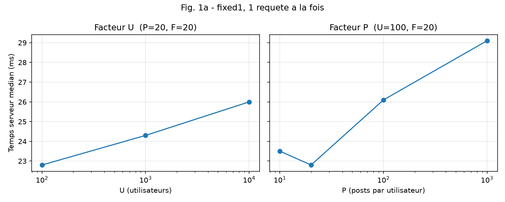
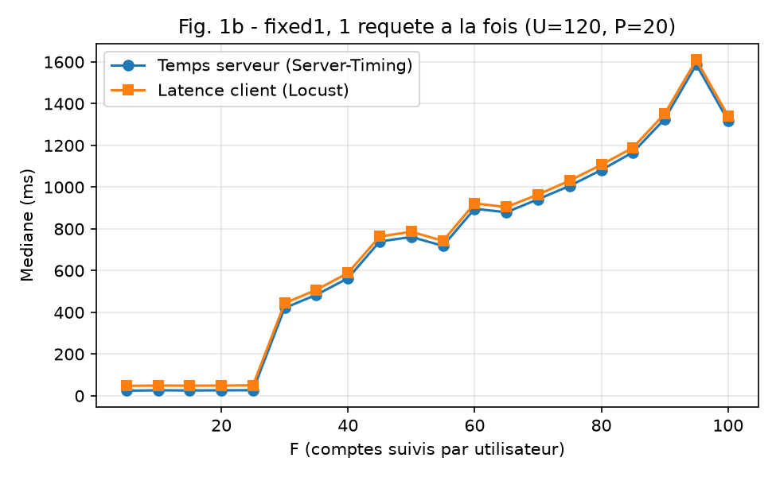
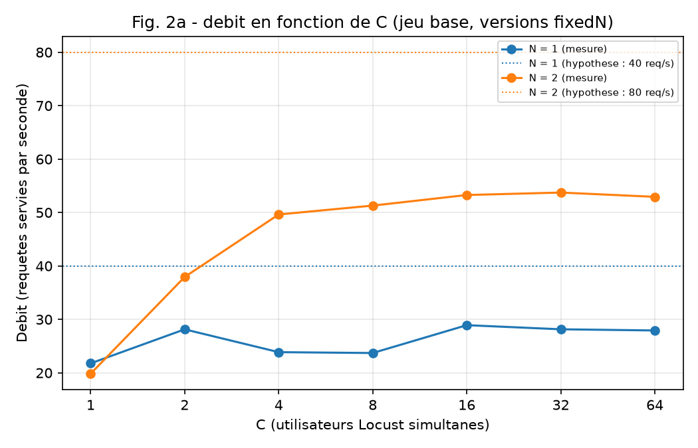
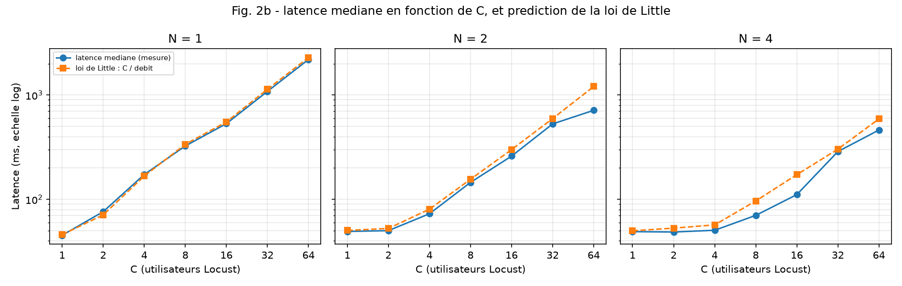

## Partie 1 : coût d'une requête

**Question :** de quoi dépend le temps de traitement d'une timeline ?

#### Hypothèse

En lisant `get_timeline` dans `main.py`, je remarque que la fonction contient deux blocs `try`, donc deux méthodes pour construire la timeline.

**Méthode 1 : requête groupée.** Elle utilise une requête (de type SQL, ici une requête Datastore) qui sélectionne les posts dont l'auteur appartient à la liste de followees récupérée. Comme on sélectionne tous les posts de ces auteurs, plus P est grand, plus la requête va mettre du temps.

**Méthode 2 : boucle.** Elle parcourt chaque auteur de la liste `follows` pour récupérer les posts de chacun. Donc, si la liste est grande, le temps de réponse l'est aussi.

**Prédiction :** si P et F augmentent, le temps de réponse du serveur augmente. En revanche, U ne semble pas influer sur la fonction, car c'est un utilisateur qui est passé en paramètre.

| Facteur | Évolution attendue du temps serveur | Mécanisme (`get_timeline`) |
|---|---|---|
| U (utilisateurs) | Pas d'effet | L'utilisateur est passé en paramètre : la fonction ne travaille que sur sa liste de followees et sur leurs posts. |
| P (posts par utilisateur) | Augmente | La requête sélectionne les posts des auteurs de la liste : plus ils en ont, plus elle est longue. |
| F (followees) | Augmente | Plus la liste `follows` est grande, plus la requête est lourde (méthode 1) et plus il y a d'itérations dans la boucle (méthode 2). |

#### Protocole

**Montage.** Version `fixed1` on garanti ainsi exactement 1 instance, sans autoscaling, une requête à la fois (Locust `-u 1 -r 1`). Projet GCP `tinyinsta-510215`, région App Engine `europe-west6`. Client de charge : Locust 2.47.0, lancé depuis Cloud Shell. Mesures réalisées le 30/10/2026.

**Jeux de données.** Chaque jeu est généré avec `bench/seed_exact.py`. Un seul facteur varie à la fois, les autres restent à leur valeur de référence.

| Facteur étudié | Jeux utilisés | U | P | F |
|---|---|---|---|---|
| U | `u100`, `base`, `u10000` | 100 / 1 000 / 10 000 | 20 | 20 |
| P | `p10`, `u100`, `p100`, `p1000` | 100 | 10 / 20 / 100 / 1 000 | 20 |
| F | `f05`, `f10`, ..., `f100` (20 jeux) | 120 | 20 | 5 / 10 / ... / 100 |

**Déroulement.**
- 26 runs, un par jeu, de 60 secondes chacun. Chaque run produit un journal brut `raw/<jeu>.csv` (une ligne par requête : latence client, temps serveur, code HTTP, instance).
- Les runs sont lancés dans un **ordre mélangé** (tirage avec graine fixe, enregistré dans `raw/order.txt`), pour que l'ordre n'avantage ni ne pénalise un facteur plus qu'un autre.
- Chaque jeu n'est mesuré qu'une seule fois.

**Traitement.**
- Pour chaque run, on calcule la médiane du temps serveur (`SERVER_MS`, en-tête `Server-Timing`, durée de `get_timeline`) et la médiane de la latence client (`LATENCY_MS`, mesurée par Locust).
- Le nombre d'instances qui ont réellement répondu est compté à partir de la colonne `INSTANCE` (en-tête `X-Instance`) : il vaut 1 pour les 26 runs. Les 26 runs n'ont renvoyé que des codes 200.

**Reproductibilité.** `scripts/campagne_p1.sh` lance les mesures. `python3 scripts/analyse_p1.py` lit `raw/` et régénère tous les CSV et PNG de `figures/` ainsi que le résumé `figures/resume_p1.csv`.

#### Figures

**Fig. 1a** : temps serveur médian (ms) en fonction de U (à gauche, avec P = 20 et F = 20) et de P (à droite, avec U = 100 et F = 20), abscisses en échelle logarithmique. `fixed1`, une requête à la fois. Valeurs tracées : `figures/fig1a.csv`.

**Fig. 1b** : temps serveur médian et latence client médiane (ms) en fonction de F, pour 20 valeurs de F (U = 120, P = 20). `fixed1`, une requête à la fois. Valeurs tracées : `figures/fig1b.csv`.

Le résumé de tous les runs (nombre de requêtes, instances distinctes, codes HTTP, médianes) est dans `figures/resume_p1.csv`.
#### Interprétation et réponses aux questions

Dans `get_timeline`, il y a deux façons de récupérer les posts. J'appelle la première la **méthode IN** : une seule requête qui demande les posts de tous les auteurs d'un coup. J'appelle la deuxième la **méthode boucle** : une requête par auteur, l'une après l'autre.

Le code essaie d'abord la méthode IN. Si Datastore refuse, l'erreur est attrapée par le `except` et le code passe à la méthode boucle, sans afficher aucun message.

J'ai fait un test directement sur Datastore avec des `IN` de plus en plus grands. Avec 30 valeurs, ça marche. Avec 31 valeurs, Datastore répond « IN supports up to 30 values ». Une timeline demande les posts de F comptes suivis plus ceux de l'utilisateur, donc F + 1 auteurs. Jusqu'à F = 29, c'est la méthode IN qui répond. À partir de F = 30, c'est la méthode boucle.

##### Question 1 : mes hypothèses sont-elles confirmées ? Sinon, qu'avais-je manqué ?

**U : confirmé.** Je pensais que U n'avait pas d'effet, car l'utilisateur est donné en paramètre. Les mesures donnent 22,8 ms pour U = 100 et 26,0 ms pour U = 10 000. Le temps serveur ne monte que de 3 ms alors qu'il y a 100 fois plus d'utilisateurs.

**P : plutôt réfuté.** Je pensais que le temps augmentait avec P, car la requête parcourt tous les posts avant d'en renvoyer 20. Les mesures donnent 23,5 ms pour P = 10 et 29,1 ms pour P = 1 000. Le temps augmente d'environ 6 ms alors que P est multiplié par 100. Si la requête lisait tous les posts, le temps serait bien plus grand. Je n'avais pas vu le `limit=20` : la requête s'arrête dès qu'elle a 20 posts. Une explication probable (mais pas certaine) est que l'index `(author, created desc)` donne déjà les posts triés par date, donc Datastore lit directement les plus récents.
**F : plutôt confirmé.** Je pensais que le temps augmentait avec F à cause de la boucle. C'est vrai, mais seulement à partir de F = 30. Jusqu'à F = 25, le temps est presque plat (24,5 ms à F = 5 et 26,9 ms à F = 25). À F = 30, il saute à 420,9 ms. Ensuite il monte presque droit jusqu'à 1 318,8 ms à F = 100. Cela fait environ 13 ms par auteur (420,9 ms pour 31 auteurs et 1 318,8 ms pour 101 auteurs). De ce que je comprends chaque requête de la boucle est un aller-retour vers Datastore. Le code parcourt toute la liste des followees, pour chacun, il demande ses posts à Datastore (l’aller), puis il attend la réponse (le retour) avant d’interroger Datastore pour le suivant dans la liste.

**Ce que j'avais manqué :**
- La limite de 30 valeurs pour `IN`.
- Le passage automatique et silencieux à la boucle quand `IN` est refusé. C'est pour ça qu'il y a une marche à F = 30 et pas une pente douce.
- Le `limit=20` : il limite le travail de la méthode IN, et pas seulement l'affichage.

##### Question 2 : quelle part de la latence client est due au réseau ?

Sur la figure 1b, la latence client est toujours un peu plus grande que le temps serveur. On le voit facilement car la courbe orange est toujours supérieur a la bleu. La différence est d'environ 23 ms, quel que soit F (entre 22 et 26 ms selon les runs). Elle ne change pas quand le temps serveur monte, j'en déduis donc qu'elle ne dépend pas du travail fait dans Datastore.

La part en pourcentage, elle, change beaucoup avec F :

| F | Temps serveur (ms) | Latence client (ms) | Différence (ms) | Part de la latence client |
|---|---|---|---|---|
| 5 | 24,5 | 47,6 | 23,1 | environ 49 % |
| 25 | 26,85 | 50,15 | 23,3 | environ 46 % |
| 30 | 420,9 | 443,8 | 22,9 | environ 5 % |
| 100 | 1 318,8 | 1 341,8 | 23,0 | environ 1,7 % |

Quand la requête est rapide, presque la moitié de la latence ne vient pas du serveur. Quand elle est lente, ça devient presque rien.

Ces 23 ms ne sont pas seulement du réseau. Ils contiennent aussi la préparation du JSON et le passage par le serveur web d'App Engine, que le temps serveur ne compte pas. La vraie part du réseau est donc au plus de 23 ms. Je ne l'ai pas séparée du reste.

##### Question 3 : combien d'entités Datastore une timeline lit-elle ? Quel coût pour 1 million de timelines ?

Une entité est un objet stocké dans Datastore, ici un `User` ou un `Post`. Google facture chaque entité lue. Plus une timeline lit d'entités, plus elle coûte cher.

**Méthode IN (F de 5 à 29) : 21 entités.**
- Le code lit d'abord l'entité `User` pour récupérer la liste des comptes suivis. C'est **1 entité**.
- Ensuite, une seule requête demande les posts de tous les auteurs, avec `limit=20`. Datastore s'arrête à 20 résultats. C'est **20 entités** `Post`, même si les auteurs ont beaucoup plus de posts.
- Au total : 1 + 20 = **21 entités**.

**Méthode boucle (F à partir de 30) : beaucoup plus.(logique)**
- Il y a toujours **1 entité** `User`.
- Ensuite, le code fait une requête par auteur, et il y a F + 1 auteurs. Le `limit=20` s'applique à **chaque requête**, donc chaque auteur donne jusqu'à 20 posts.
- Au total : 1 + 20 × (F + 1) entités.
- Pour F = 30 : 31 auteurs × 20 = 620, plus 1 = **621 entités**.
- Pour F = 100 : 101 auteurs × 20 = 2 020, plus 1 = **2 021 entités**.
- À la fin, le code trie tous ces posts et n'en garde que 20. Tout le reste a été lu, payé, et jeté (quel gâchis).

**Selon U, P et F :**
- **U** ne change rien : 21 entités. On lit toujours un `User` et 20 posts.
- **P** ne change rien dans mes mesures : 21 entités. Pour les jeux de P, F vaut 20, donc c'est la méthode IN. Même avec P = 10, les 21 auteurs ont 210 posts en tout, donc la requête en trouve toujours 20.
- **F** change tout : 21 entités jusqu'à F = 29, puis 621 à F = 30 et 2 021 à F = 100.

**Le prix.** Pour Zurich (europe-west6), en mode Datastore, une lecture d'entité coûte **0,042 $ pour 100 000 lectures**. Je l'ai lu sur la page de tarification de Google le 31/10/2026. Les 50 000 premières lectures par jour sont gratuites, mais je ne les compte pas.

**Le calcul pour 1 million de timelines :**
1. On multiplie le nombre d'entités par 1 000 000 pour avoir le nombre de lectures.
2. On divise par 100 000 pour savoir combien de paquets de 100 000 on paye.
3. On multiplie par 0,042 $.

Exemple pour 21 entités : 21 × 1 000 000 = 21 000 000 lectures, soit 210 paquets, soit 210 × 0,042 = 8,82 $.

Autrement dit, chaque entité lue par timeline coûte 0,42 $ pour 1 million de timelines.

| Cas | Méthode | Entités lues par timeline | Lectures pour 1 million de timelines | Coût de 1 million de timelines |
|---|---|---|---|---|
| U de 100 à 10 000 (P = 20, F = 20) | IN | 21 | 21 000 000 | 8,82 $ |
| P de 10 à 1 000 (U = 100, F = 20) | IN | 21 | 21 000 000 | 8,82 $ |
| F de 5 à 25 | IN | 21 | 21 000 000 | 8,82 $ |
| F = 30 | boucle | 621 | 621 000 000 | 260,82 $ |
| F = 100 | boucle | 2 021 | 2 021 000 000 | 848,82 $ |

Quand F passe de 25 à 30, le coût est multiplié par environ 30 (de 8,82 $ à 260,82 $). À F = 100, il est environ 96 fois plus élevé qu'à F = 25.

### 2.2 Partie 2 : capacité

**Question :** combien de timelines par seconde une instance peut-elle servir ? Le débit maximal est-il proportionnel au nombre d'instances ?

#### Hypothèse

**Ce que je lis dans le code.** Dans `app.yaml`, l'application est lancée avec `entrypoint: gunicorn -b :$PORT main:app`, sans aucune option. La documentation de gunicorn dit que le worker par défaut traite une seule requête à la fois (https://gunicorn.org/design/). Une instance n'a donc qu'un seul worker, et elle traite **une requête à la fois**. Avec N instances, N requêtes sont traitées en même temps.

**Les deux outils utilisés.**
- La loi de Little : latence ≈ C ÷ débit, donc débit = C ÷ latence.
- Une instance qui traite une requête à la fois a un débit maximal de 1 ÷ (temps pendant lequel elle est occupée par une requête). Avec N instances, c'est N ÷ ce temps.

**Les chiffres de la partie 1.** Avec C = 1 sur le jeu `base`, la latence médiane est d'environ 48 ms, soit un débit d'environ 20 requêtes par seconde. Mais la latence est le temps total vu par le client. L'instance n'est pas occupée pendant tout ce temps : une partie sert au voyage de la réponse sur le réseau. J'estime que l'instance est occupée la moitié de la latence, soit environ 24 ms (c'est le temps serveur de la partie 1). Son débit maximal est alors de 1 ÷ 0,024 s, soit environ 40 requêtes par seconde.

C'est une estimation, pas une mesure. L'instance fait aussi d'autres choses (Flask, fabrication du JSON) que le temps serveur ne compte pas. Je considère donc que 40 requêtes par seconde est **au plus** ce qu'une instance peut faire.

**La saturation.** La saturation arrive quand C × (temps d'occupation) dépasse la latence sans charge, c'est-à-dire pour C ≈ débit maximal × latence sans charge. Pour une instance : 40 × 0,048 s ≈ 1,92, soit **C ≈ 2**. Pour N instances, C ≈ 2N.

| N (instances) | Débit maximal prédit | C de saturation prédit |
|---|---|---|
| 1 | environ 40 req/s | environ 2 |
| 2 | environ 80 req/s | environ 4 |
| 4 | environ 160 req/s | environ 8 |

**La latence prédite.** Avant la saturation, la latence reste proche de celle de la partie 1, environ 48 ms. Après la saturation, les requêtes attendent leur tour, et la latence vaut environ C ÷ débit maximal. Par exemple, pour N = 1 et C = 16, elle vaut environ 16 ÷ 40 = 0,4 s, soit 400 ms. Je m'attends donc à ce que la loi de Little reste vraie après la saturation.

**Proportionnalité.** En théorie, le débit maximal est proportionnel à N, car chaque instance traite ses requêtes seule, sans partager de mémoire avec les autres. Je m'attends à un gain proche de 4 en passant de 1 à 4 instances, peut-être un peu inférieur. Les instances partagent tout de même Datastore, et App Engine répartit les requêtes entre elles, ce qui peut être inégal. Si le gain est inférieur à 4, le goulot viendrait de l'un de ces deux points. Je le vérifierai avec la colonne `INSTANCE` (combien de requêtes sert chaque instance) et avec `SERVER_MS` (est-ce que le temps passé dans `get_timeline` monte avec C ?).

#### Protocole

**Montage.** J'ai mesuré trois versions à instances fixes : `fixed1b` (1 instance), `fixed2` (2 instances) et `fixed4` (4 instances), avec le jeu de données `base` (U = 1 000, P = 20, F = 20). Projet GCP `tinyinsta-510215`, région `europe-west6`. Le client de charge est Locust 2.47.0, lancé depuis Cloud Shell. Les versions `fixedN` utilisent une instance de classe B1 (celle que fixe le script `deploy_fixed.sh`), alors que la version par défaut utilise F1.

Pour N = 1, j'ai utilisé `fixed1b` et non `fixed1`. La version `fixed1` était bloquée par une opération App Engine restée en attente. `fixed1b` est déployée avec exactement la même configuration.

**Déroulement.**
- Une version à la fois : je la déploie, je fais toutes ses mesures, puis je l'arrête (`gcloud app versions stop`).
- Pour chaque version, 7 runs avec C = 1, 2, 4, 8, 16, 32 et 64 utilisateurs Locust simultanés, soit 21 runs au total.
- Chaque run dure 60 secondes. Chaque utilisateur Locust envoie une nouvelle requête dès qu'il reçoit la réponse.
- Avant chaque série, un échauffement de 25 secondes (non conservé) réveille toutes les instances.
- Les C d'une même version sont lancés dans un ordre mélangé (tirage avec graine fixe, enregistré dans `raw/p2_N<N>_order.txt`).
- Avant les mesures, le script vérifie que la version est `SERVING`, qu'elle a bien N instances, que le jeu `base` renvoie 20 posts et que les en-têtes `X-Instance` et `Server-Timing` sont présents.
- Chaque (N, C) n'est mesuré qu'une seule fois.
- Dates : le 9 novembre 2026. `fixed1b` entre 10h15 et 10h37 (en deux sessions, voir les limites), `fixed2` entre 10h56 et 11h03, `fixed4` : <!-- À compléter : date et heures -->.

**Traitement.**
- Je retire les 5 premières secondes de chaque run et je ne garde que les réponses HTTP 200.
- Le **débit** est le nombre de réponses 200 divisé par la durée entre le début de la première requête et la fin de la dernière.
- Je calcule la latence médiane et la latence moyenne, et la prédiction de la loi de Little : latence ≈ C ÷ débit.
- Le nombre d'instances qui ont répondu est compté avec la colonne `INSTANCE` (en-tête `X-Instance`).

**Reproductibilité.** `bash scripts/campagne_p2.sh N` lance les mesures d'une version. `python3 scripts/analyse_p2.py` (ou `bash scripts/regenerer_figures.sh` pour toutes les figures) régénère les CSV et les images. Les journaux bruts sont dans `raw/p2_N<N>_C<C>.csv`.

#### Figures

**Fig. 2a** : débit (requêtes servies par seconde) en fonction de C, une courbe par valeur de N. Jeu `base`. Les lignes pointillées sont les débits prédits dans mon hypothèse (40, 80 et 160 requêtes par seconde). Valeurs tracées : `figures/fig2a.csv`.

**Fig. 2b** : latence médiane en fonction de C, pour N = 1, 2 et 4, avec la latence moyenne mesurée et la prédiction de la loi de Little (C ÷ débit). Échelle logarithmique. Valeurs tracées : `figures/fig2b.csv`.

Le résumé de tous les runs est dans `figures/resume_p2.csv`, et la capacité de chaque N dans `figures/capacite_p2.csv`.

#### Interprétation

**Mon hypothèse comparée aux mesures.**

| Ce que j'avais prédit | Ce que j'ai mesuré | Verdict |
|---|---|---|
| Une instance traite une requête à la fois | Capacité par instance presque identique pour N = 1, 2 et 4 | Confirmé |
| Débit maximal d'une instance : environ 40 req/s (donc 40, 80 et 160) | 28,9, 53,7 et 108,3 req/s | Réfuté : environ 30 % plus bas |
| Saturation vers C = 2, 4 et 8 | C = 2, C = 4 et environ C = 32 | Juste pour N = 1 et N = 2, faux pour N = 4 |
| Latence d'environ 48 ms avant la saturation | 45 ms (N = 1), 49 ms (N = 2 et N = 4) à C = 1 | Confirmé |
| La loi de Little reste vraie après la saturation | Vraie sur la latence moyenne | Confirmé |
| Gain proche de 4 entre 1 et 4 instances, un peu inférieur | × 3,74 à × 3,81 | Confirmé |

**Ce que j'avais manqué.** J'avais supposé qu'une instance était occupée pendant 24 ms par requête, soit le temps passé dans `get_timeline`. En réalité, elle est occupée environ 36 ms. L'instance fait donc aussi d'autres choses en dehors de `get_timeline` (Flask, fabrication du JSON). Cette part d'environ 14 ms est déduite de mes chiffres, je ne l'ai pas mesurée directement.

---

**Question 1 : où se situe le point de saturation pour chaque N ? Quelle est la capacité d'une instance, et qu'est-ce qui la limite ?**

**Réponse.** La saturation arrive à C = 2 pour N = 1, à C = 4 pour N = 2 et vers C = 32 pour N = 4, où la courbe monte encore un peu jusqu'à C = 64. Une instance sert environ 28 timelines par seconde. Ce qui la limite, c'est son worker `gunicorn` : il n'y en a qu'un par instance et il traite une seule requête à la fois. Pendant que `get_timeline` attend la réponse de Datastore, ce worker ne peut pas s'occuper d'une autre requête.

**Justification.**
- Je définis la saturation comme le premier C qui atteint 90 % du débit maximal de ce N.
- Pour N = 1, le débit est de 28,1 req/s à C = 2, pour un maximum de 28,9. Pour N = 2, il est de 49,6 à C = 4, pour un maximum de 53,7.
- Pour N = 4, la courbe monte lentement : 70 req/s à C = 4, 83 à C = 8, 93 à C = 16, 106 à C = 32 et 108 à C = 64.
- Le débit maximal divisé par N donne 28,9, 26,9 et 27,1 req/s par instance. Cette valeur est presque la même quel que soit N, comme pour un guichet qui sert un client à la fois : ajouter des instances ajoute des guichets.
- Une instance est occupée environ 36 ms par requête (1 ÷ 28 req/s). Le temps passé dans `get_timeline` est d'environ 21 à 26 ms, soit 60 à 70 % de ce temps d'occupation.
- Pour N = 1, le temps serveur reste entre 21 et 23 ms quand C passe de 1 à 64, alors que la latence passe de 45 ms à 2 195 ms. Les requêtes attendent donc **avant** d'entrer dans `get_timeline`, derrière l'unique worker.
- Pour N = 4, la saturation arrive plus tard que prévu. Une explication possible est que les requêtes ne sont pas parfaitement réparties : à C = 64, l'instance la plus chargée sert 28,3 % des requêtes au lieu de 25 %. Je n'ai pas vérifié que c'est la cause.

---

**Question 2 : la loi de Little est-elle vérifiée au-delà de la saturation ?**

**Réponse.** Oui, quand on la compare à la latence **moyenne**. Elle n'est pas vérifiée sur la latence médiane quand C est grand, et elle s'écarte de la moyenne dans les runs qui contiennent des requêtes en échec.

**Justification.**
- La loi de Little dit que latence moyenne ≈ C ÷ débit. Elle est presque évidente dans mon montage : chaque utilisateur Locust renvoie une requête dès qu'il reçoit la réponse, donc il y a toujours C requêtes en cours.
- Dans les runs avec 0 à 2 échecs, l'écart entre C ÷ débit et la latence moyenne est d'au plus 0,6 %. Cela comprend des runs bien au-delà de la saturation : N = 1 à C = 4 (0,3 %), N = 2 à C = 8 (0,5 %) et N = 4 à C = 8 (0,4 %).
- La latence médiane, elle, est plus basse que la moyenne quand C est grand. À N = 2 et C = 64, la médiane est de 714 ms et la moyenne de 1 167 ms. À N = 4 et C = 64, la médiane est de 462 ms et la moyenne de 584 ms. Quelques requêtes très longues tirent la moyenne vers le haut. La loi de Little parle de la moyenne, pas de la médiane.
- L'écart grandit dans les runs avec beaucoup d'échecs :

| N | C | Échecs | Écart entre Little et la latence moyenne |
|---|---|---|---|
| 1 | 16 | 8 | 14,6 % |
| 2 | 16 | 9 | 16,6 % |
| 4 | 16 | 8 | 13,5 % |
| 4 | 32 | 9 | 10,5 % |
| 2 | 32 | 6 | 7,2 % |
| 1 | 32 | 6 | 5,1 % |
| 1 | 64 | 3 | 4,5 % |
| 2 | 64 | 4 | 3,6 % |
| 4 | 64 | 3 | 1,3 % |

- Mon explication est la suivante : une requête en échec fait perdre du temps à un utilisateur Locust, mais elle n'est comptée ni dans le débit ni dans la latence moyenne, qui ne gardent que les réponses 200. Donc C ÷ débit devient trop grand. Ce n'est pas la saturation qui crée l'écart, car les runs saturés sans échec n'en ont presque pas. <!-- À compléter après la vérification : durée mesurée des requêtes en échec (commande sur raw/p2_N*_C16.csv) -->

---

**Question 3 : passer de 1 à 4 instances multiplie-t-il le débit maximal par 4 ? Sinon, où est le goulot ?**

**Réponse.** Presque. Le débit maximal est multiplié par 1,86 avec 2 instances et par 3,74 avec 4 instances (3,81 si je prends la moyenne des deux plus grands C). Cela fait environ 94 à 95 % de la proportionnalité parfaite. Je ne peux pas affirmer qu'il y a un goulot qui bloque le passage à plusieurs instances. Ce qui limite chaque instance, c'est son worker unique.

**Justification.**

| N | Débit maximal (req/s) | Débit moyen à C = 32 et 64 (req/s) | Rapport avec N = 1 (maximum) | Rapport avec N = 1 (moyenne) |
|---|---|---|---|---|
| 1 | 28,9 | 28,0 | 1,00 | 1,00 |
| 2 | 53,7 | 53,3 | 1,86 | 1,90 |
| 4 | 108,3 | 106,9 | 3,74 | 3,81 |

- L'écart de 5 à 6 % est du même ordre que le bruit entre les runs. Pour N = 1 seul, le débit à saturation va de 23,7 à 28,9 req/s selon C (28,1 à C = 2, environ 24 à C = 4 et 8, puis 28 à 29 à C = 16, 32 et 64). Je ne peux donc pas dire que 6 % de perte est un vrai goulot.
- Quelques pistes possibles pour cette petite perte, que je n'ai pas testées :
  - Une répartition un peu inégale à forte charge. L'instance la plus chargée sert 53,7 % des requêtes à N = 2 (50 % idéal) et 28,3 % à N = 4 (25 % idéal), à C = 64.
  - Le Datastore est partagé par toutes les instances. Le temps serveur médian est de 24 à 26 ms pour N = 2 et N = 4, contre 21 à 23 ms pour N = 1.
  - À N = 4, le débit monte encore entre C = 32 et C = 64. Le débit maximal est peut-être un peu sous-estimé, car le sujet interdit de dépasser 64 utilisateurs.
- À C = 2, N = 2 et N = 4 ont presque le même débit (37,9 et 37,7 req/s). Ce n'est pas un défaut : avec 2 requêtes en même temps, 2 instances suffisent, et les 2 autres n'ont rien à faire.
- Le goulot n'est pas dans le code de `get_timeline`. Dans cette partie, F vaut 20, donc `get_timeline` utilise toujours la méthode `IN`. Et son temps ne monte pas quand C augmente.

---

**Limites de cette partie (pour la section Validité).**
- Chaque couple (N, C) n'a été mesuré qu'une fois.
- N = 1 a été mesuré en deux sessions. La version `fixed1b` a été arrêtée puis redémarrée entre les runs C = 2, 4, 8 et les runs C = 1, 16, 32, 64. Cela peut expliquer en partie les débits plus bas à C = 4 et 8, mais je ne l'ai pas démontré.
- Pour N = 4 et C = 2, le journal contient 6 identifiants d'instance au lieu de 4. La liste des instances relevée avant et après la campagne montre que deux instances ont été remplacées par App Engine pendant la campagne. Je n'ai pas identifié la cause. Ce run ne contient aucune requête en échec et son débit est cohérent avec celui de N = 2 à la même concurrence.
- Les requêtes en échec (code HTTP 0) vont de 0 à 9 par run, soit moins de 0,5 % des requêtes. Elles apparaissent à partir de C = 8 (une seule pour N = 4 à C = 4).
- Le sujet limite C à 64 et N à 4. Le débit maximal de N = 4 n'est donc peut-être pas atteint.
#### Interprétation

<!-- À compléter : point de saturation pour chaque N, capacité d'une instance et ce qui la limite, loi de Little au-delà de la saturation, rapport entre 1 et 4 instances, ce que j'avais manqué. -->

