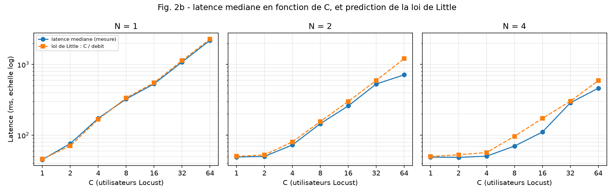

# TinyInsta passe-t-elle à l'échelle ?

Projet Données Massives et Cloud – Benchmark, édition 2026  
Yasmine BOUR – rendu individuel – novembre 2026

- Application déployée (version par défaut) : https://tinyinsta-510215.oa.r.appspot.com
- Dépôt : https://github.com/YasmineBour/Projet_tinyInsta_2026

## Introduction

TinyInsta est un petit réseau social. Un utilisateur poste des messages et suit d'autres utilisateurs. Sa *timeline* est la liste des 20 messages les plus récents des comptes qu'il suit et des siens. L'application tourne sur Google App Engine, et les données sont stockées dans Google Cloud Datastore.

La question du projet est : TinyInsta passe-t-elle à l'échelle ? Si la réponse est nuancée, il faut dire ce qui passe à l'échelle, jusqu'où, et pourquoi. Dans ce projet, « passer à l'échelle » a deux sens précis :

- **Les données.** Quand un paramètre des données est multiplié par 10, le temps d'une requête reste à peu près constant. Il y a trois paramètres : U, le nombre d'utilisateurs ; P, le nombre de posts de chaque utilisateur ; F, le nombre de comptes que chaque utilisateur suit (les *followees*).
- **Les ressources.** Quand le nombre d'instances N est multiplié par k, le nombre de requêtes servies par seconde est multiplié par environ k. Une instance est une copie de l'application qui tourne sur une machine de Google.

Mon travail a trois parties. Dans la partie 1, je mesure ce que coûte une timeline selon U, P et F. Dans la partie 2, je mesure combien de timelines par seconde servent 1, 2 et 4 instances. Dans la partie 3, je corrige un problème trouvé dans les deux premières parties et je refais la mesure. Chaque partie commence par une hypothèse, écrite avant de mesurer, à partir de la lecture du code.

**Ce que je trouve, en résumé.** TinyInsta passe à l'échelle sur U, sur P et sur N. Elle ne passe pas à l'échelle sur F : à partir de 30 comptes suivis, le temps d'une timeline est multiplié par 16 parce que le code change de méthode sans prévenir. Ma correction rend le temps 9 à 18 fois plus court pour F ≥ 30, mais il continue d'augmenter avec F. La conclusion en section 3 détaille tout cela.

---

## 1. Montage

L'application est dans le projet GCP `tinyinsta-510215`, sur App Engine en région `europe-west6` (Zurich). Les données sont dans Cloud Datastore (Firestore en mode Datastore).

Le client qui envoie les requêtes est Locust 2.47.0 (Python 3.12). Je le lance depuis Cloud Shell. La machine Cloud Shell est en zone `europe-west1-b` (Belgique), d'après le serveur de métadonnées de Google. Le client et l'application ne sont donc pas dans la même région.

### 1.1 Les versions de l'application

Pour mesurer, j'ai utilisé des versions à instances fixes, sans autoscaling. Chacune a été arrêtée dès la fin de ses mesures, car une instance fixe est facturée tant qu'elle tourne.

| Version | Instances | Classe | Utilisée pour | Date (heures en UTC) |
|---|---|---|---|---|
| `20260930t152203` (version par défaut) | autoscaling, au plus 10 | F1 | L'URL rendue. Elle contient l'ancien code. | déployée le 30/09/2026 |
| `fixed1` | 1 | B1 | Partie 1 | 30/10/2026, de 19h06 à 19h33 environ |
| `fixed1b` | 1 | B1 | Partie 2, N = 1 | 09/11/2026, de 10h15 à 10h37 (deux sessions) |
| `fixed2` | 2 | B1 | Partie 2, N = 2 | 09/11/2026, de 10h56 à 11h03 |
| `fixed4` | 4 | B1 | Partie 2, N = 4 | 09/11/2026, de 11h11 à 11h19 environ |
| `fixchunk` | 1 | B1 | Partie 3 (version corrigée, `--no-promote`) | 19/11/2026, de 10h19 à 10h40 |

Table 1 – Les versions de l'application.

Les versions `fixedN` et `fixchunk` sont de classe B1, parce que c'est ce que fixe le script `deploy_fixed.sh`.

### 1.2 Les jeux de données

Je mesure sur 26 jeux de données, soit environ 400 000 entités. Je les ai générés un par un avec `bench/seed_exact.py`. Dans chaque jeu, chaque utilisateur a exactement P posts et suit exactement F autres utilisateurs. Un seul paramètre change d'un jeu à l'autre, les autres gardent leur valeur de référence.

| Facteur étudié | Jeux | U | P | F |
|---|---|---|---|---|
| U | `u100`, `base`, `u10000` | 100, 1 000, 10 000 | 20 | 20 |
| P | `p10`, `u100`, `p100`, `p1000` | 100 | 10, 20, 100, 1 000 | 20 |
| F | `f05`, `f10`, …, `f100` (20 jeux) | 120 | 20 | 5, 10, …, 100 |

Table 2 – Les jeux de données. Le point P = 20 est mesuré sur `u100`, qui a 100 utilisateurs et 20 posts.
 `base` a été généré le 28/10/2026 et les autres jeux le 30/10/2026.

### 1.3 Comment je mesure

Locust simule des utilisateurs qui envoient des requêtes à `/api/timeline`. Chaque utilisateur Locust envoie une nouvelle requête dès qu'il reçoit la réponse précédente. Un *run* est une mesure de 60 secondes avec un nombre fixe d'utilisateurs Locust. Pour chaque requête, le journal brut garde deux temps :

- le **temps serveur**, mesuré par l'application autour de la fonction `get_timeline` et renvoyé dans l'en-tête `Server-Timing`. C'est le temps passé à construire la timeline, surtout à interroger Datastore ;
- la **latence client**, mesurée par Locust : le temps total entre l'envoi de la requête et la réception de la réponse. Elle contient le temps serveur, plus le réseau et tout ce que fait l'application autour de `get_timeline`.

Le journal garde aussi le code HTTP et l'instance qui a répondu (en-tête `X-Instance`). Pour chaque run, je retire les 5 premières secondes et je ne garde que les réponses 200. J'en tire des médianes. Avant chaque campagne, je fais un échauffement de quelques secondes, non conservé, pour que le démarrage à froid d'une instance ne fausse pas le premier run. L'ordre des runs est mélangé avec une graine fixe, et noté dans `raw/`. Chaque point est mesuré une seule fois.

### 1.4 Deux incidents

- La version `fixed1` est restée bloquée par une opération App Engine en attente, après un redéploiement par-dessus une version arrêtée. Pour N = 1 en partie 2, j'ai donc utilisé `fixed1b`, déployée avec exactement la même configuration.
- Ma première campagne de la partie 3 a donné des runs vides, à cause d'une erreur de mon script : une commande de délai maximal empêchait Locust de démarrer. J'ai corrigé le script et j'ai refait toute la campagne. Les journaux des tentatives ratées ne sont pas utilisés.

---

## 2. Résultats

### 2.1 Partie 1 : de quoi dépend le temps d'une timeline ?

#### Mon hypothèse

J'ai lu la fonction `get_timeline` dans `main.py`. Je remarque qu'elle contient deux blocs `try`, donc deux méthodes pour construire la timeline.

La première utilise une requête (de type SQL, ici une requête Datastore) qui sélectionne les posts dont l'auteur appartient à la liste de followees récupérée. Comme on sélectionne tous les posts de ces auteurs, plus P est grand, plus la requête va mettre du temps. Je l'appelle la *méthode IN*.

La deuxième parcourt chaque auteur de la liste `follows` et récupère les posts de chacun, l'un après l'autre. Donc, si la liste est grande, le temps de réponse l'est aussi. Je l'appelle la *méthode boucle*.

J'en déduis que le temps serveur augmente si P et F augmentent. En revanche, U ne semble pas influer sur la fonction, car c'est un utilisateur qui est passé en paramètre : elle ne travaille que sur sa liste de followees et sur leurs posts.

#### Protocole

Je mesure la version `fixed1`, qui a une seule instance, avec un seul utilisateur Locust. Il n'y a donc qu'une requête à la fois, ce qui supprime l'effet de l'autoscaling et de la concurrence. Je fais 26 runs de 60 secondes, un par jeu de la table 2. Chaque run interroge `<jeu>_u00000`, c'est-à-dire toujours le même utilisateur, car `bench/locustfile.py` attribue les utilisateurs TinyInsta dans l'ordre à chaque utilisateur Locust (voir la section 4.5).

#### Résultats


Figure 1a – Temps serveur médian en fonction de U (à gauche, avec P = 20 et F = 20) et de P (à droite, avec U = 100 et F = 20). Abscisses en échelle logarithmique. Valeurs : `figures/fig1a.csv`.


Figure 1b – Temps serveur médian et latence client médiane en fonction de F (U = 120, P = 20). Valeurs : `figures/fig1b.csv`.

**U n'a presque pas d'effet.** Le temps serveur est de 22,8 ms pour U = 100 et de 26,0 ms pour U = 10 000. Il n'augmente que de 3 ms alors qu'il y a 100 fois plus d'utilisateurs.

**P a un effet faible.** Le temps passe de 23,5 ms (P = 10) à 29,1 ms (P = 1 000), soit environ 6 ms de plus pour 100 fois plus de posts. Si la requête lisait tous les posts avant d'en garder 20, le temps serait beaucoup plus grand. Je n'avais pas vu que la requête a un `limit=20` : elle s'arrête dès qu'elle a 20 posts. L'index `(author, created desc)` donne probablement déjà les posts de chaque auteur triés par date, mais je ne l'ai pas mesuré.

**F a un effet énorme, mais pas comme je l'imaginais.** Jusqu'à F = 25, le temps est presque plat : 24,5 ms à F = 5 et 26,9 ms à F = 25. À F = 30, il saute à 421 ms. Ensuite il monte presque en ligne droite jusqu'à 1 319 ms à F = 100. Ce n'est pas une pente douce : c'est une marche.

#### Pourquoi le temps saute à F = 30

Une timeline porte sur F + 1 auteurs : les F comptes suivis, plus l'utilisateur lui-même. Le code essaie d'abord la méthode IN. Si Datastore refuse la requête, l'erreur est attrapée par un `except` qui ne fait rien, et le code passe à la méthode boucle sans afficher aucun message.

J'ai fait un test directement sur Datastore avec des `IN` de plus en plus grands. Avec 30 valeurs, ça marche. Avec 31 valeurs, Datastore répond « IN supports up to 30 values ». Donc, tant que F + 1 ≤ 30, c'est-à-dire jusqu'à F = 29, la méthode IN répond, avec une seule requête. À partir de F = 30, Datastore la refuse et le code passe à la méthode boucle : une requête par auteur, envoyées l'une après l'autre.

Chaque requête de la boucle est un aller-retour vers Datastore : l'application pose la question, attend la réponse, puis pose la question suivante. Les temps s'additionnent. À F = 30, il y a 31 requêtes, soit 421 ms ; à F = 100, il y en a 101, soit 1 319 ms. Cela fait environ 13 ms par auteur, ce qui explique la pente après la marche.

#### Mon hypothèse face aux mesures

- **U : confirmé.** Je pensais qu'il n'avait pas d'effet, et c'est ce que je mesure.
- **P : plutôt réfuté.** Je pensais que le temps augmentait nettement avec P. Il n'augmente que de 24 % pour 100 fois plus de posts, parce que la requête s'arrête à 20 posts.
- **F : le sens est juste, mais pas la forme.** Le temps augmente bien avec F, mais seulement à partir de F = 30, par un saut brutal, et non progressivement.

Ce que j'avais manqué : la limite de 30 valeurs de `IN`, le passage silencieux à la boucle, et le rôle du `limit=20`.

#### Quelle part de la latence vient du réseau ?

Sur la figure 1b, la latence client est toujours un peu plus grande que le temps serveur. L'écart est d'environ 23 ms, quel que soit F (entre 22 et 26 ms selon les runs). Il ne change pas quand le temps serveur monte : il ne dépend donc pas du travail fait dans Datastore. En revanche, sa part dans la latence change beaucoup :

| F | Temps serveur | Latence client | Écart | Part de la latence |
|---|---|---|---|---|
| 5 | 24,5 ms | 47,6 ms | 23,1 ms | environ 49 % |
| 25 | 26,9 ms | 50,2 ms | 23,3 ms | environ 46 % |
| 30 | 420,9 ms | 443,8 ms | 22,9 ms | environ 5 % |
| 100 | 1 318,8 ms | 1 341,8 ms | 23,0 ms | environ 1,7 % |

Table 3 – L'écart entre la latence client et le temps serveur.

Quand la requête est rapide, presque la moitié de la latence ne vient pas du serveur. Quand elle est lente, ce n'est presque rien. Ces 23 ms ne sont pas seulement du réseau : ils contiennent aussi surement la préparation du JSON et le passage par le serveur web d'App Engine. La vraie part du réseau est donc au plus de 23 ms, et je ne l'ai pas séparée du reste.

#### Combien d'entités Datastore une timeline lit-elle, et combien ça coûte ?

Une entité est un objet stocké dans Datastore, ici un `User` ou un `Post`. Google facture chaque entité lue.

Avec la méthode IN, le code lit d'abord l'entité `User` de la personne pour récupérer sa liste de comptes suivis : 1 entité. Les followees ne sont pas lus, car leurs noms sont déjà dans cette liste. Ensuite, une seule requête demande les posts de tous les auteurs, avec `limit=20` : Datastore s'arrête à 20 résultats. Cela fait 1 + 20 = **21 entités**, même si les auteurs ont des milliers de posts.

Avec la méthode boucle, il y a toujours 1 entité `User`, mais le `limit=20` s'applique à chaque requête. Chacun des F + 1 auteurs donne donc jusqu'à 20 posts : 1 + 20 × (F + 1) entités. À F = 30, c'est 621 entités. À F = 100, c'est 2 021. À la fin, le code garde 20 posts et jette tout le reste : il a lu et payé presque tout pour rien.

U et P ne changent pas ce nombre : on lit toujours un `User` et 20 posts. Pour les jeux de P, F vaut 20, donc c'est la méthode IN, et même avec P = 10, les 21 auteurs ont 210 posts, assez pour en trouver 20.

Pour le coût, je prends le prix de Zurich en mode Datastore, lu sur la page de tarification de Google le 31/10/2026 : 0,042 $ pour 100 000 lectures d'entités. Pour un million de timelines, je multiplie le nombre d'entités par 1 000 000, je divise par 100 000 pour avoir le nombre de paquets de 100 000 lectures, puis je multiplie par 0,042 $. Par exemple, 21 entités donnent 21 millions de lectures, soit 210 paquets, soit 8,82 $. Chaque entité lue par timeline coûte donc 0,42 $ pour un million de timelines.

| Cas | Méthode | Entités par timeline | Coût d'un million de timelines |
|---|---|---|---|
| U ou P quelconque, ou F de 5 à 25 | IN | 21 | 8,82 $ |
| F = 30 | boucle | 621 | 260,82 $ |
| F = 100 | boucle | 2 021 | 848,82 $ |

Table 4 – Entités lues et coût d'un million de timelines, selon F.

Quand F passe de 25 à 30, le coût est multiplié par environ 30. Ces nombres sont déduits du code, je ne les ai pas mesurés dans la facturation. Je ne compte pas non plus les éventuelles lectures d'entrées d'index, ni les 50 000 lectures gratuites par jour.

#### Ce qu'il faut retenir de la partie 1

- Le temps d'une timeline ne dépend presque pas de U ni de P.
- Il dépend de F, avec un saut brutal à F = 30, à cause de la limite de 30 valeurs de `IN` et du passage silencieux à la boucle.
- À partir de F = 30, une timeline lit des dizaines de fois plus d'entités : elle est plus lente et beaucoup plus chère.

---

### 2.2 Partie 2 : combien de timelines par seconde ?

#### Mon hypothèse

Dans `app.yaml`, l'application est lancée avec `entrypoint: gunicorn -b :$PORT main:app`, sans aucune option. D'après la documentation de gunicorn, le worker par défaut traite une seule requête à la fois (https://gunicorn.org/design/). Une instance n'a donc qu'un seul worker, qui traite une requête à la fois. Avec N instances, N requêtes sont traitées en même temps.

J'utilise deux outils. Le premier est la loi de Little : la latence moyenne vaut environ C ÷ débit, où C est le nombre d'utilisateurs Locust simultanés. Le deuxième est le débit maximal d'une instance qui traite une requête à la fois : 1 ÷ (le temps pendant lequel elle est occupée par une requête).

Dans la partie 1, avec C = 1 sur `base`, la latence médiane est d'environ 48 ms, soit environ 20 requêtes par seconde. Mais la latence est le temps total vu par le client, et l'instance n'est pas occupée pendant tout ce temps : une partie sert au voyage de la réponse. J'estime que l'instance est occupée la moitié de la latence, soit environ 24 ms, qui est le temps serveur de la partie 1. Son débit maximal serait alors de 1 ÷ 0,024 s, soit environ 40 requêtes par seconde. C'est une estimation, et même un maximum : l'instance fait aussi surement d'autres choses que le temps serveur ne compte pas.

La saturation arrive quand C est égal au débit maximal multiplié par la latence sans charge : 40 × 0,048 s ≈ 2 pour une instance, donc environ 2N pour N instances.

| N | Débit maximal prédit | C de saturation prédit |
|---|---|---|
| 1 | environ 40 req/s | environ 2 |
| 2 | environ 80 req/s | environ 4 |
| 4 | environ 160 req/s | environ 8 |

Table 5 – Mes prédictions pour la partie 2.

Avant la saturation, je m'attends à une latence proche de 48 ms. Après, les requêtes attendent leur tour et la latence vaut environ C ÷ débit maximal, par exemple 16 ÷ 40 = 0,4 s pour N = 1 et C = 16. Je m'attends donc à ce que la loi de Little reste vraie après la saturation.

En théorie, le débit maximal est proportionnel à N, car chaque instance traite ses requêtes seule. J'attends un gain proche de 4 entre 1 et 4 instances, peut-être un peu inférieur, parce que les instances partagent Datastore et qu'App Engine peut répartir les requêtes de façon inégale. Je le vérifierai avec la colonne `INSTANCE` (combien de requêtes sert chaque instance) et avec le temps serveur (monte-t-il avec C ?).

#### Protocole

Je mesure `fixed1b` (N = 1), `fixed2` (N = 2) et `fixed4` (N = 4), une version à la fois, sur le jeu `base`. Pour chaque version, je fais 7 runs de 60 secondes avec C = 1, 2, 4, 8, 16, 32 et 64 utilisateurs Locust, soit 21 runs. Avant chaque série, le script vérifie que la version a bien N instances, que `base` renvoie 20 posts et que les en-têtes `X-Instance` et `Server-Timing` sont là. Je définis le **débit** comme le nombre de réponses 200 divisé par la durée entre le début de la première requête et la fin de la dernière. Avec C utilisateurs Locust, les C premiers utilisateurs du jeu `base` sont interrogés.

#### Résultats


Figure 2a – Débit en fonction de C, une courbe par valeur de N (jeu `base`). Les lignes pointillées sont les débits prédits (40, 80 et 160 requêtes par seconde). Valeurs : `figures/fig2a.csv`.



Figure 2b – Latence médiane en fonction de C, pour N = 1, 2 et 4, avec la latence moyenne mesurée et la prédiction de la loi de Little (C ÷ débit). Échelle logarithmique. Valeurs : `figures/fig2b.csv`. Le résumé de tous les runs est dans `figures/resume_p2.csv`.

**La saturation.** Je la définis comme le premier C qui atteint 90 % du débit maximal de ce N. Pour N = 1, le débit est de 28,1 requêtes par seconde à C = 2, pour un maximum de 28,9 : la saturation arrive à C = 2, comme je l'avais prédit. Pour N = 2, il est de 49,6 à C = 4, pour un maximum de 53,7 : C = 4, là aussi comme prévu. Pour N = 4, la courbe monte plus lentement : 70 requêtes par seconde à C = 4, 83 à C = 8, 93 à C = 16, 106 à C = 32 et 108 à C = 64. La saturation arrive donc vers C = 32, et non à C = 8. 

**La capacité d'une instance.** Le débit maximal est de 28,9, 53,7 et 108,3 requêtes par seconde. Divisé par N, cela donne 28,9, 26,9 et 27,1 requêtes par seconde par instance : environ 28, à peu près le même pour tous les N. C'est environ 30 % de moins que mes 40 prédites. Une instance est occupée environ 36 ms par requête (1 ÷ 28), alors que le temps passé dans `get_timeline` est de 21 à 26 ms, soit 60 à 70 % de ce temps. Je m'étais donc trompée en prenant 24 ms comme temps d'occupation : il reste environ 14 ms, déduites de mes chiffres et non mesurées, pour tout ce que l'instance fait en dehors de `get_timeline`.

**Ce qui limite une instance.** C'est son worker `gunicorn` : il n'y en a qu'un par instance, et il traite une seule requête à la fois. Pendant que `get_timeline` attend la réponse de Datastore, il ne peut pas traiter une autre requête. Deux observations confirment que les requêtes attendent avant d'entrer dans `get_timeline`, derrière ce worker. Pour N = 1, le temps serveur reste entre 21 et 23 ms quand C passe de 1 à 64, alors que la latence passe de 45 ms à 2 195 ms. Et la capacité par instance est la même quel que soit N : comme un guichet qui sert un client à la fois, ajouter des instances ajoute des guichets.

**La loi de Little reste vraie après la saturation, sur la latence moyenne.** Dans les runs avec 0 à 2 requêtes en échec, l'écart entre C ÷ débit et la latence moyenne est d'au plus 0,6 %, y compris bien après la saturation : 0,3 % pour N = 1 à C = 4, 0,5 % pour N = 2 à C = 8. Elle ne colle pas à la latence médiane quand C est grand : pour N = 2 et C = 64, la médiane est de 714 ms et la moyenne de 1 167 ms. Quelques requêtes très longues tirent la moyenne vers le haut, et la loi de Little parle de la moyenne.

L'écart avec la moyenne grandit dans les runs qui contiennent des requêtes en échec : 14,6 % pour N = 1 à C = 16 (8 échecs), 16,6 % pour N = 2 à C = 16 (9 échecs), 13,5 % pour N = 4 à C = 16 (8 échecs), contre 1 à 5 % pour les runs à C = 64 avec 3 ou 4 échecs. Ces échecs sont des erreurs de résolution de nom (`gaierror` dans la colonne `ERROR`) : le client n'a pas trouvé l'adresse de l'application, donc la requête n'a probablement jamais atteint le serveur. À C = 16, chaque requête en échec a duré 10, 15 ou 20 secondes. Pendant ce temps, l'utilisateur Locust n'a reçu aucune réponse : ce temps est perdu, mais il n'est compté ni dans le débit ni dans la latence moyenne, qui ne gardent que les réponses 200. Donc C ÷ débit devient trop grand. Ce n'est pas la saturation qui crée l'écart, car les runs saturés sans échec n'en ont presque pas.

**Passer de 1 à 4 instances multiplie presque le débit par 4.**

| N | Débit maximal | Débit moyen à C = 32 et 64 | Rapport avec N = 1 (maximum) | Rapport avec N = 1 (moyenne) |
|---|---|---|---|---|
| 1 | 28,9 req/s | 28,0 req/s | 1,00 | 1,00 |
| 2 | 53,7 req/s | 53,3 req/s | 1,86 | 1,90 |
| 4 | 108,3 req/s | 106,9 req/s | 3,74 | 3,81 |

Table 6 – La capacité selon N.

Le débit est multiplié par 1,9 avec 2 instances et par 3,8 avec 4, soit environ 94 à 95 % de la proportionnalité parfaite. Je ne peux pas affirmer qu'il existe un goulot qui bloque le passage à plusieurs instances : pour N = 1 seul, le débit à saturation va de 23,7 à 28,9 requêtes par seconde selon C. Quelques pistes, que je n'ai pas testées : la répartition un peu inégale des requêtes à forte charge, le Datastore partagé (le temps serveur est de 24 à 26 ms pour N = 2 et N = 4, contre 21 à 23 ms pour N = 1), et le fait que N = 4 monte encore entre C = 32 et C = 64, donc que son maximum est peut-être sous-estimé. Le goulot n'est pas dans le code de `get_timeline` : avec F = 20, c'est toujours la méthode IN, et son temps ne monte pas avec C.

À C = 2, N = 2 et N = 4 ont presque le même débit (37,9 et 37,7 requêtes par seconde).

#### Mon hypothèse face aux mesures

La plupart de mes prédictions sont confirmées : une instance traite une requête à la fois, la saturation arrive à C = 2 et C = 4 pour N = 1 et N = 2, la latence est d'environ 48 ms avant la saturation (45 ms pour N = 1, 49 ms pour N = 2 et N = 4 à C = 1), la loi de Little reste vraie sur la moyenne, et le gain entre 1 et 4 instances est proche de 4. Deux points sont faux : le débit maximal d'une instance est d'environ 28 requêtes par seconde et non 40, et la saturation de N = 4 arrive vers C = 32 et non C = 8.

#### Ce qu'il faut retenir de la partie 2

- Une instance sert environ 28 timelines par seconde, parce que son worker `gunicorn` traite une requête à la fois.
- Le débit est presque proportionnel au nombre d'instances (× 3,8 avec 4).
- La loi de Little est vraie sur la latence moyenne, même après la saturation.

---

### 2.3 Partie 3 : corriger et re-mesurer

#### Le problème choisi et mon hypothèse

Je choisis le passage de `get_timeline` à la méthode boucle quand F ≥ 30. En partie 1, il fait passer le temps serveur de 27 ms (F = 25) à 421 ms (F = 30), puis à 1 319 ms (F = 100), et une timeline lit jusqu'à 2 021 entités au lieu de 21.

Mon idée de départ était de n'utiliser que la méthode IN, pour ne jamais passer dans la boucle. Ce n'est pas possible tel quel : Datastore refuse un `IN` de plus de 30 valeurs. J'ai donc retenu l'autre idée : faire en sorte que la boucle se comporte comme le IN. Je découpe la liste des auteurs en groupes de 30 au plus, et je fais une requête IN par groupe, avec `limit=20`. Je rassemble les résultats, je les trie par date et je garde les 20 plus récents. Le résultat reste correct, car les 20 posts les plus récents de l'ensemble font forcément partie des 20 plus récents de leur groupe.

```python
MAX_IN = 30  # Datastore refuse un filtre IN de plus de 30 valeurs

def _groupes(liste, taille):
    for i in range(0, len(liste), taille):
        yield liste[i:i + taille]

# dans get_timeline, à la place du try / except et de la boucle :
posts = []
for groupe in _groupes(follows, MAX_IN):
    query = client.query(kind='Post')
    query.add_filter('author', 'IN', groupe)
    query.order = ['-created']
    posts.extend(list(query.fetch(limit=limit)))
return sorted(posts, key=lambda p: p.get('created'), reverse=True)[:limit]
```

Le nombre de requêtes passe de F + 1 à (F + 1) ÷ 30 arrondi vers le haut : 4 au lieu de 101 à F = 100. Moins de requêtes veut dire moins d'allers-retours vers Datastore, donc un temps plus court, et moins d'entités lues : 1 + 20 × le nombre de groupes.

Cette correction a un coût :

- **Complexité** : quelques lignes en plus.
- **Elle ne supprime pas le problème** : les requêtes restent envoyées l'une après l'autre, donc le temps continue d'augmenter avec F, par paliers.
- **Cohérence des données** : je ne change aucune donnée. Mais on fait plusieurs requêtes à des instants légèrement différents, donc un post écrit entre deux requêtes peut apparaître ou non. La boucle d'origine avait déjà ce défaut.
- **Erreurs** : je supprime le `try / except` silencieux. Si Datastore refuse une requête, on le verra, au lieu d'avoir un ralentissement caché.
- **Argent** : elle coûte moins cher, car elle lit moins d'entités.

Une autre solution serait de calculer la timeline de chaque utilisateur au moment où un post est écrit. La lecture serait très rapide, mais chaque écriture devrait être copiée chez tous les abonnés, et il faudrait gérer ceux qui suivent ou arrêtent de suivre. Je ne la retiens pas : c'est beaucoup plus compliqué.

**Ce que je prédis.** Pour F ≤ 29, rien ne change : une seule requête IN, environ 27 ms. Pour F ≥ 30, comme les requêtes sont envoyées l'une après l'autre, le temps sera plus grand qu'à F ≤ 29 mais bien plus petit que dans l'ancienne boucle : à F = 30, beaucoup plus proche de 27 ms que de 420 ms. Si une requête IN prend environ 27 ms, le temps vaut au plus 27 ms multiplié par le nombre de requêtes, soit environ 54 ms pour F de 30 à 59, 81 ms pour F de 60 à 89 et 108 ms pour F de 90 à 100. Les 27 ms comprennent aussi la lecture de l'utilisateur, donc le temps réel sera peut-être un peu plus bas. La courbe aura la forme d'un escalier : le temps ne change pas tant que le nombre de requêtes reste le même, puis il saute tous les 30 comptes suivis.

#### Protocole

J'ai déployé la version corrigée sous le nom `fixchunk`, avec `--no-promote`, avec la même configuration que `fixed1` : une instance fixe de classe B1. Seul le code de `get_timeline` change. J'ai refait exactement le protocole de la figure 1b : un seul utilisateur Locust, les 20 jeux `f05` à `f100`, 60 secondes par run, ordre mélangé, mêmes échauffement et traitement. Les 20 runs ont été servis par une seule instance et ne contiennent que des réponses 200.

#### Résultats


Figure 3 – Avant et après la correction (U = 120, P = 20, une instance, une requête à la fois). À gauche, temps serveur et latence client médians en échelle linéaire. À droite, temps serveur en échelle logarithmique. Valeurs : `figures/fig3.csv`.

| F | Temps serveur avant | Temps serveur après | Gain | Latence client avant | Latence client après |
|---|---|---|---|---|---|
| 25 | 26,9 ms | 31,6 ms | × 0,85 | 50,2 ms | 59,3 ms |
| 30 | 420,9 ms | 46,3 ms | × 9,1 | 443,8 ms | 74,2 ms |
| 60 | 896,3 ms | 71,2 ms | × 12,6 | 921,9 ms | 100,4 ms |
| 100 | 1 318,8 ms | 91,4 ms | × 14,4 | 1 341,8 ms | 119,3 ms |

Table 7 – Avant et après la correction.

La correction apporte un gain net pour F ≥ 30 : le temps serveur est divisé par 9 à 18 selon F, avec un maximum de × 18,1 à F = 95. À F = 100, l'application sert 451 requêtes en 60 secondes, contre 39 avant. La courbe a bien la forme d'un escalier : on voit des marches à F = 30, 60 et 90.

**Pourquoi le gain est si grand.** À F = 100, la timeline faisait 101 requêtes l'une après l'autre, d'environ 13 ms chacune. Maintenant elle en fait 4. Elle lit aussi 81 entités au lieu de 2 021. Le temps passe de 1 319 ms à 91 ms, et le coût d'un million de timelines de 849 $ à 34 $, soit 25 fois moins. Ce coût est déduit du code. À F = 30, il passe de 261 $ à 17 $.

**Mon hypothèse face aux mesures.** Les prédictions sont confirmées : à F = 30, 46 ms, bien plus proche de 27 que de 420 ; 46, 71 et 91 ms à F = 30, 60 et 100, tous sous les bornes de 54, 81 et 108 ms ; et une courbe en escalier. Il y a trois points que j'avais mal estimés :

- **Pour F ≤ 25, la version corrigée est un peu plus lente**, de 2 à 5 ms sur le temps serveur (26,6 ms au lieu de 24,5 ms à F = 5). Je ne pense pas que le code en soit la cause : pour F ≤ 25, il n'y a qu'un groupe, donc le code fait presque la même chose qu'avant. De plus, la partie de la latence qui n'est pas dans `get_timeline` (l'écart entre la latence client et le temps serveur) passe de 23 ms à environ 28 ms, alors que le code ne la touche pas. Les mesures d'avant et d'après n'ont pas été faites le même jour.
- **Chaque groupe ajouté coûte environ 15 à 21 ms**, et non 27 ms. Mes 27 ms comprenaient aussi la lecture de l'utilisateur, faite une seule fois.
- **Le temps monte un peu à l'intérieur d'une marche** (46 ms à F = 30, 53 ms à F = 45). Le nombre de requêtes n'explique donc pas tout : une requête avec plus d'auteurs prend un peu plus de temps.

**Est-ce que ça passe à l'échelle sur F ?** Le sujet demande que le temps reste à peu près constant quand F est multiplié par 10. De F = 10 à F = 100, le temps serveur était multiplié par 50 avant la correction, et il est multiplié par 3 après (28 ms puis 91 ms). Ce n'est pas constant, mais c'est bien meilleur.

**La correction ne change pas les résultats.** J'ai comparé les timelines de l'ancienne version (la version par défaut) et de la nouvelle pour `f05_u00001`, `f20_u00001`, `f30_u00001` et `f100_u00001`. Pour ces quatre utilisateurs, les 20 posts sont les mêmes, dans le même ordre.

#### Ce qu'il faut retenir de la partie 3

- Découper les auteurs en groupes de 30 supprime le passage à la boucle : le temps est divisé par 9 à 18 pour F ≥ 30, et le coût aussi.
- Il reste un escalier : le temps augmente toujours avec F, car les requêtes sont envoyées l'une après l'autre. Pour aller plus loin, on pourrait les envoyer en parallèle, ou précalculer les timelines. Je n'ai testé aucune de ces idées.

---

## 3. Tableau des verdicts et conclusion

| Dimension | Passe à l'échelle ? | Jusqu'où ? | Pourquoi (mécanisme) | Preuve |
|---|---|---|---|---|
| Utilisateurs (U) | Oui | Jusqu'à 10 000 utilisateurs (testé) | Une timeline lit seulement l'entité `User` demandée et 20 posts, quelle que soit la taille de la base. Le temps serveur passe de 22,8 ms à 26,0 ms. | Fig. 1a |
| Posts par utilisateur (P) | Oui, presque | Jusqu'à 1 000 posts par utilisateur (testé) | La requête s'arrête à 20 posts (`limit=20`). Le temps passe de 23,5 ms à 29,1 ms, soit 24 % de plus pour 100 fois plus de posts. L'index `(author, created desc)` l'explique probablement. | Fig. 1a |
| Followees (F) | Non | Version d'origine : jusqu'à F = 29. Après correction : sous 100 ms jusqu'à F = 100, mais le temps augmente toujours | `IN` accepte au plus 30 valeurs. À partir de F = 30, le code passe en silence à une requête par auteur, l'une après l'autre (421 ms à F = 30, 1 319 ms à F = 100). Ma correction envoie les auteurs par groupes de 30 (91 ms à F = 100), mais le temps monte encore par paliers. | Fig. 1b et Fig. 3 |
| Instances (N) | Oui | Jusqu'à 4 instances (limite du sujet) | Chaque instance traite ses requêtes seule : le débit maximal est multiplié par 1,9 avec 2 instances et par 3,8 avec 4. | Fig. 2a et Fig. 2b |

Table 8 – Les verdicts.

### Conclusion

TinyInsta passe à l'échelle en partie, et elle a un point faible. Sur les données, U et P ne posent pas de problème : le temps d'une timeline reste presque constant quand U est multiplié par 100 ou P par 100, parce que la timeline ne lit qu'un utilisateur et 20 posts. Sur les ressources, le débit est presque proportionnel au nombre d'instances, jusqu'à 4. Chaque instance ne sert cependant qu'environ 28 timelines par seconde, parce que son worker `gunicorn` traite une requête à la fois. Pour servir beaucoup de requêtes, il faudrait donc beaucoup d'instances : cela passe à l'échelle, mais pas de façon économique.

Le point faible est F. Dans la version d'origine, le temps passe de 27 ms à 421 ms entre F = 25 et F = 30, et monte jusqu'à 1 319 ms. La raison est que `IN` accepte au plus 30 valeurs : au-delà, le code passe en silence à une requête par auteur, envoyées l'une après l'autre. Ma correction, des requêtes IN par groupes de 30, divise le temps par 9 à 18 et le coût par 15 à 25. Mais le temps n'est toujours pas constant : il monte par paliers, une marche tous les 30 comptes suivis. De F = 10 à F = 100, il est multiplié par 3 au lieu de 50.

Mes tests ne vont pas plus loin que U = 10 000, P = 1 000, F = 100, N = 4 et C = 64, et je n'ai rien mesuré au-delà. Je n'ai pas non plus testé les deux pistes pour aller plus loin : envoyer les requêtes en parallèle, ou calculer la timeline de chaque utilisateur au moment où un post est écrit.

---

## 4. Validité

### 4.1 Combien d'instances ont répondu à chaque mesure ?

Autant que prévu : une instance pour les parties 1 et 3, N instances pour la partie 2. Je compte les instances avec la colonne `INSTANCE` de chaque journal. Les requêtes en échec n'ont pas d'identifiant, donc je ne les compte pas. Pour la partie 2, le script vérifie en plus avant chaque campagne que la version est `SERVING` avec N instances listées par `gcloud`, et je garde la liste avant et après dans `raw/p2_N<N>_instances_avant.txt` et `_apres.txt`.

Il y a une exception : pour N = 4 et C = 2, le journal contient 6 identifiants au lieu de 4. La liste avant et après la campagne montre que deux instances ont été remplacées par App Engine pendant la campagne. Je n'ai pas trouvé pourquoi. Ce run ne contient aucune requête en échec et son débit est cohérent avec celui de N = 2 à la même concurrence, donc je l'ai gardé.

### 4.2 Mes runs sont-ils indépendants ? L'ordre des mesures compte-t-il ?

Pas complètement. Mes runs sont enchaînés sur la même instance, sans la redémarrer entre deux runs. J'ai mélangé leur ordre avec une graine fixe (`raw/order.txt`, `raw/p2_N<N>_order.txt`, `raw/p3_order.txt`), pour qu'un facteur ne soit pas toujours mesuré avant ou après un autre. Mais cela ne prouve pas que l'ordre n'a pas d'effet, et je ne l'ai pas testé.

Il y a du bruit entre les runs. Pour N = 1, la mesure a été faite en deux sessions : la version a été arrêtée puis redémarrée entre les runs C = 2, 4, 8 et les runs C = 1, 16, 32, 64. Le débit à C = 4 et C = 8 est d'environ 24 requêtes par seconde, contre 28 à 29 à C = 16, 32 et 64. Cet écart de 15 % pour un même N montre que le bruit existe. Comme chaque point n'est mesuré qu'une fois, je ne connais pas la variation d'un même run refait. Enfin, les mesures d'avant et d'après la correction n'ont pas été faites le même jour, ce qui peut expliquer les 2 à 5 ms d'écart à F ≤ 25.

### 4.3 Quelle part de la latence vient du réseau ?

Au plus 23 ms en partie 1 et 28 ms en partie 3, quel que soit F. C'est l'écart entre la latence client et le temps serveur : il ne change pas quand le temps serveur augmente, donc il ne dépend pas du travail dans Datastore. Mais il contient aussi la préparation du JSON et le passage par le serveur web d'App Engine, donc la vraie part du réseau est plus petite, et je ne l'ai pas séparée. Le client est en Belgique et l'application à Zurich, ce qui explique sans doute une partie de ces millisecondes. En pourcentage, la part dépend de F : environ 49 % de la latence à F = 5, mais seulement 1,7 % à F = 100 dans la version d'origine.

### 4.4 Qu'ai-je compté comme un échec ? Quels codes HTTP ai-je observés ?

J'ai compté comme échec toute requête qui n'a pas reçu de réponse HTTP (code 0 dans mes journaux). J'ai observé seulement deux codes, 200 et 0, et aucune erreur 5xx.

Les parties 1 et 3 ne contiennent que des réponses 200. En partie 2, les échecs vont de 0 à 9 par run, soit moins de 0,5 % des requêtes. Il n'y en a pas pour C ≤ 2, une seule pour N = 4 et C = 4, et ils deviennent réguliers à partir de C = 8 ou 16. Je les retire des médianes et du débit, qui ne gardent que les réponses 200. Tous ceux que j'ai regardés (C = 16, pour N = 1, 2 et 4) sont des erreurs `gaierror` : le client n'a pas pu résoudre le nom de l'application. Ils ont duré 10, 15 ou 20 secondes. Ils viennent donc probablement du client, Cloud Shell, et pas de l'application, mais je ne l'ai pas démontré. Ils montrent aussi que le client de charge a une limite, alors que le sujet demande de supposer qu'il n'est pas un goulot.

### 4.5 Ma mesure exerce-t-elle bien le chemin de code que je crois ?

Oui, pour la question « méthode IN ou méthode boucle ? ». Un test direct sur Datastore accepte un `IN` de 30 valeurs et en refuse 31, et ce seuil correspond au saut du temps serveur entre F = 25 et F = 30. Avant chaque run, le script vérifie que la timeline de `<jeu>_u00001` renvoie bien 20 posts. En partie 2, F vaut 20, donc `get_timeline` utilise toujours la méthode IN, qui n'est pas concernée par le seuil. En partie 3, les timelines de l'ancienne et de la nouvelle version sont identiques pour les quatre utilisateurs testés.

J'ai une réserve. Dans `bench/locustfile.py`, chaque utilisateur Locust reçoit un utilisateur TinyInsta dans l'ordre : `<jeu>_u00000`, puis `_u00001`, etc. Avec un seul utilisateur Locust (`-u 1`), chaque run des parties 1 et 3 mesure donc toujours `<jeu>_u00000`, environ mille fois. Le mécanisme que j'étudie (le nombre de requêtes selon F) ne dépend pas de l'utilisateur, mais mes courbes décrivent un seul utilisateur par jeu. En partie 2, avec C utilisateurs Locust, ce sont les C premiers utilisateurs de `base` qui sont interrogés.
<!-- À compléter : résultat de la vérification que <jeu>_u00000 renvoie 20 posts dans chaque jeu -->

### 4.6 Combien ma campagne a-t-elle coûté ?

D'après la page Facturation, elle a consommé 1,93 $ avant remises : 1,47 $ de lectures Datastore (3,65 millions), 0,43 $ d'écritures (383 305) et 0,03 $ de stockage d'images. Les heures d'instance n'ont rien coûté : j'en ai utilisé 5,35 heures de B1 et 4,47 heures de F1 sur toute la période, sous les quotas gratuits quotidiens d'App Engine. Des crédits ont couvert la totalité du montant : je n'ai rien payé. C'est en dessous de l'estimation du sujet (moins de 1 $ pour les données, 2 à 5 $ pour l'ensemble des mesures), et très loin de mon alerte de 20 $. Le détail est dans la section 5.

---

## 5. Coût de la campagne

J'ai créé une alerte budgétaire à 20 $ dans Facturation, Budgets et alertes. Elle n'a pas été déclenchée.

### 5.1 La facturation

Voici le relevé de la page Facturation, Rapports, regroupé par SKU, le 25/11/2026, pour les 90 derniers jours. Il couvre tout le projet, pas seulement les trois parties de ce rapport.

| SKU | Utilisation | Coût d'utilisation |
|---|---|---|
| Cloud Firestore Read Ops Zurich (lectures d'entités) | 3 651 206 | 1,47 $ |
| Cloud Firestore Entity Writes Zurich (écritures d'entités) | 383 305 | 0,43 $ |
| Artifact Registry Storage | 1,29 gibibyte-mois | 0,03 $ |
| Backend Instances Zurich (versions B1, `fixedN` et `fixchunk`) | 5,35 heures | 0,00 $ |
| Frontend Instances Zurich (version par défaut, F1) | 4,47 heures | 0,00 $ |
| Cloud Firestore Small Ops Zurich | 14 060 | 0,00 $ |
| Autres lignes (stockage Firestore 0,28 gibibyte-mois, bande passante sortante 0,08 gibibyte, Cloud Build 6,15 minutes, journaux 0,12 gibibyte, transferts de données) | — | 0,00 $ |
| **Total** | | **1,93 $** |

Table 9 – La facturation par SKU.

Des crédits de −1,93 $ couvrent la totalité : le sous-total à payer est de 0,00 $.

Les lectures et les écritures représentent presque tout le coût : 1,90 $ sur 1,93 $. Les heures d'instance sont gratuites. D'après la page de tarification d'App Engine, les instances B1 ont 9 heures gratuites par jour et les instances F1 en ont 28, et je suis très loin de ces limites. Le stockage Artifact Registry (0,03 $) correspond probablement aux images créées à chaque déploiement, mais je ne l'ai pas vérifié.

Les prix ne sont pas exactement ceux du tarif plein, à cause des quotas gratuits quotidiens : 3 651 206 lectures au prix de 0,042 $ pour 100 000 donneraient 1,53 $, et la facture est de 1,47 $. Les 0,06 $ d'écart correspondent à peu près aux 50 000 lectures gratuites de quelques jours.

### 5.2 Mon estimation face à la facturation

J'ai estimé les lectures et les écritures avant de regarder la facturation, avec `python3 scripts/cout_estime.py`. Pour les lectures, je compte les réponses 200 de chaque journal brut et je les multiplie par le nombre d'entités lues par timeline, déduit du code (21 pour la méthode IN, 1 + 20 × (F + 1) pour la boucle, 1 + 20 × le nombre de groupes pour la version corrigée). Pour les écritures, je suppose que chaque entité des 26 jeux est écrite une fois. Je n'ai pas déduit les quotas gratuits.

| Poste | Mon estimation | Facturation |
|---|---|---|
| Lectures | 3 403 972 | 3 651 206 |
| Écritures | 394 800 | 383 305 |

Table 10 – Mon estimation et la facturation.

Mon estimation des lectures est inférieure de 7 % à la facturation. C'est ce que j'attendais : je ne compte ni les échauffements, ni les runs de test, ni mes vérifications à la main. Elle se répartit en 1 483 050 lectures pour la partie 1, 1 280 076 pour la partie 2 et 640 846 pour la partie 3. La partie 1 est la plus chère alors qu'elle a servi peu de requêtes pour F ≥ 30, parce qu'une timeline de l'ancienne boucle lit jusqu'à 2 021 entités. Mon estimation des écritures est supérieure de 3 % à la facturation, peut-être parce que certaines entités n'ont pas été écrites comme je le suppose. Je ne l'ai pas vérifié.

Sur le coût, mes estimations donnaient 1,43 $ de lectures et 0,50 $ d'écritures, soit 1,93 $. La facturation donne 1,47 $ et 0,43 $, soit 1,90 $, plus 0,03 $ de stockage d'images. Les deux totaux sont égaux, mais c'est en partie un hasard : mes lectures sont sous-estimées, mes écritures sur-estimées, et je n'ai pas déduit les quotas gratuits. Le plus important est que l'estimation à partir des journaux est proche de la facturation : on peut donc se fier aux nombres d'entités lues déduits du code.

---

## Organisation du dépôt

- `README.md` : ce rapport.
- `raw/` : tous les journaux bruts produits par `bench/locustfile.py` (parties 1, 2 et 3), les listes d'instances et les ordres des runs.
- `figures/` : les figures (PNG) et les valeurs tracées (CSV, avec les unités dans les noms de colonnes) : `fig1a`, `fig1b`, `fig2a`, `fig2b`, `fig3`, plus les résumés `resume_p1.csv`, `resume_p2.csv`, `capacite_p2.csv`, `fig3_cout.csv`.
- `scripts/` : les scripts de mesure (`campagne_p1.sh`, `campagne_p2.sh`, `campagne_p3.sh`), d'analyse (`analyse_p1.py`, `analyse_p2.py`, `analyse_p3.py`), le correctif de la partie 3 (`appliquer_correctif_p3.py`) et l'estimation du coût (`cout_estime.py`).
- `main.py`, `app.yaml`, `deploy_fixed.sh`, `index.yaml`, `bench/` : fournis par l'énoncé. `main.py` contient la correction de la partie 3.
- `SUJET.md` : l'énoncé.

Pour refaire les mesures : `./deploy_fixed.sh 1` puis `bash scripts/campagne_p1.sh` pour la partie 1 ; `bash scripts/campagne_p2.sh N` (avec N = 1, 2 ou 4) pour la partie 2 ; `python3 scripts/appliquer_correctif_p3.py` puis `bash scripts/campagne_p3.sh` pour la partie 3.

Pour régénérer toutes les figures à partir des journaux bruts avec une seule commande : `bash scripts/regenerer_figures.sh`.
